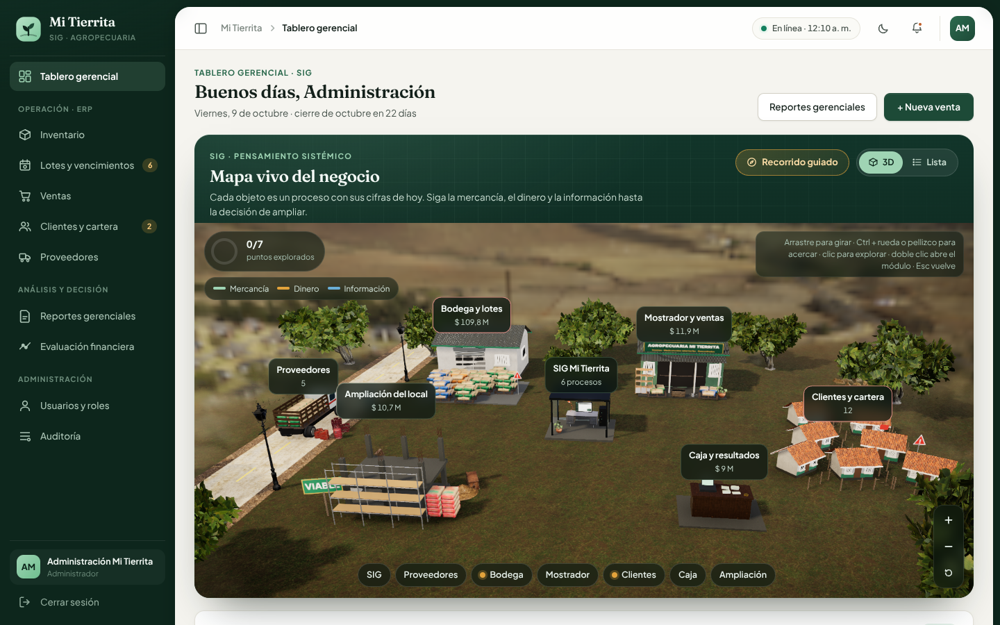
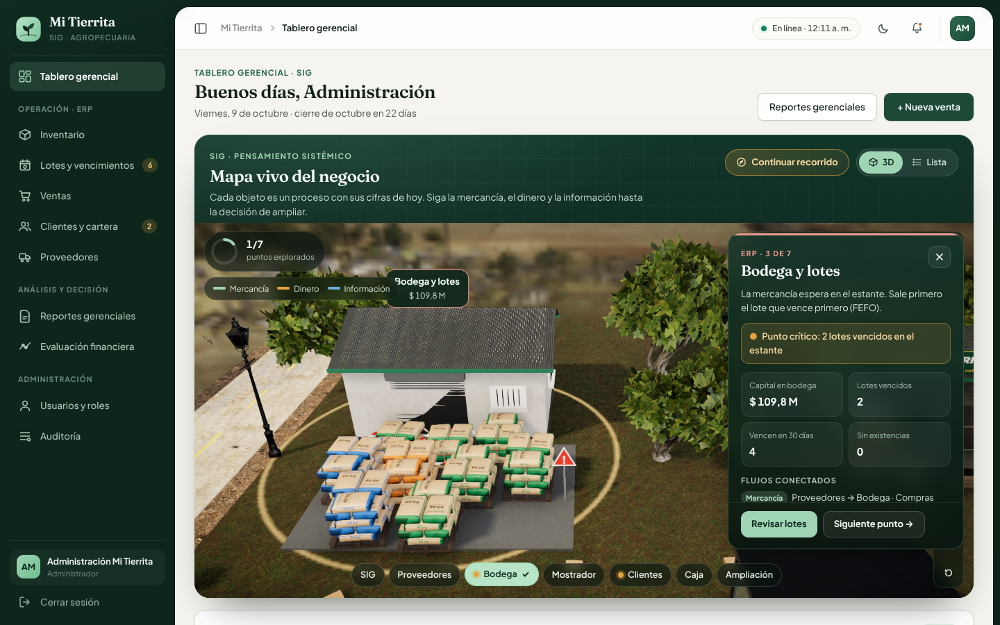
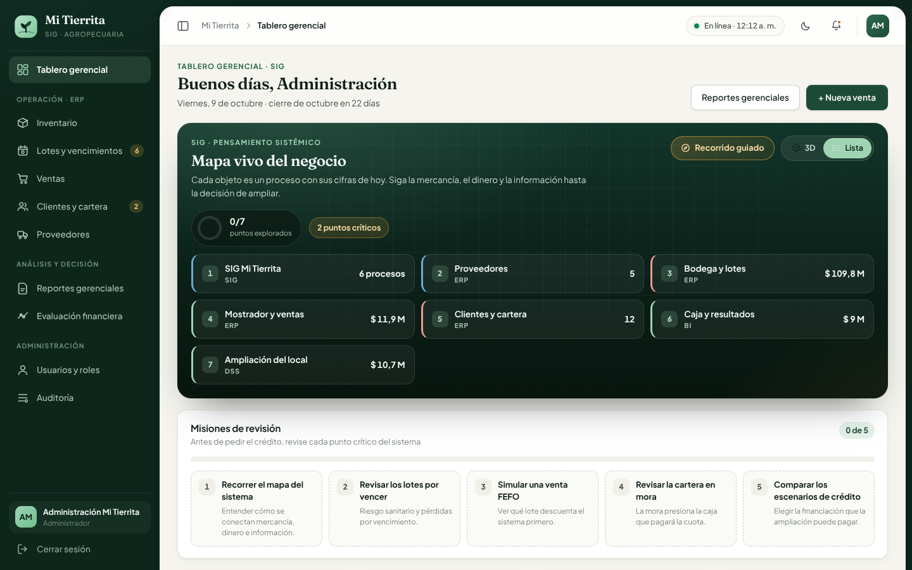
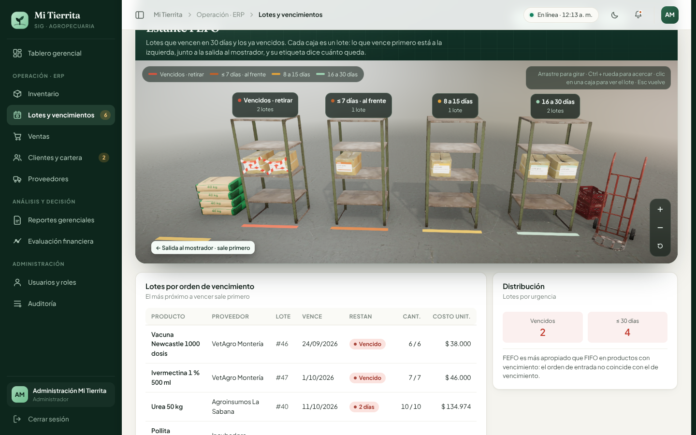
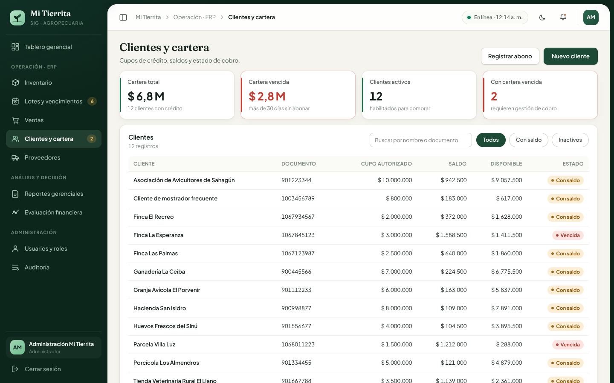
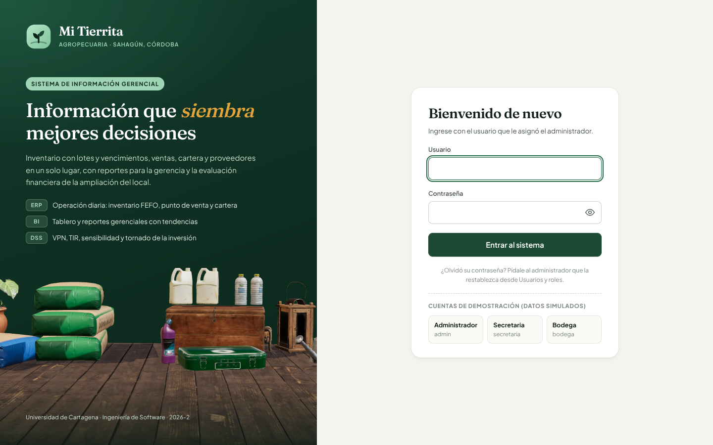
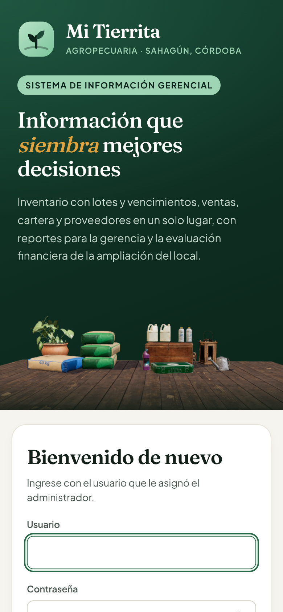
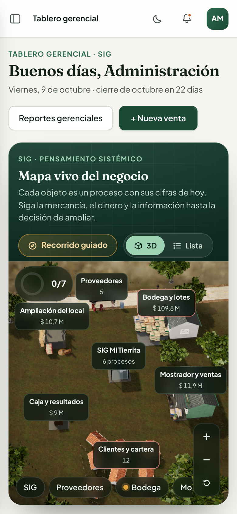
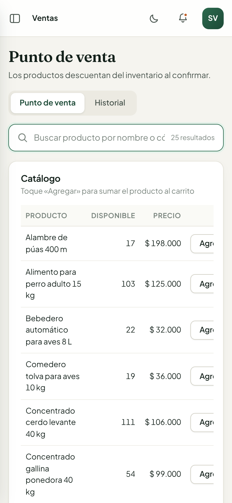
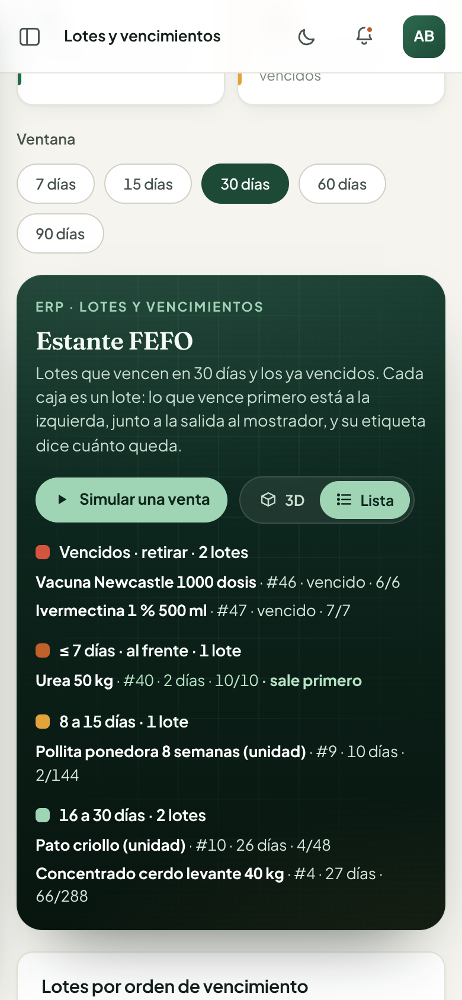

# UNIVERSIDAD DE CARTAGENA
## Ingeniería de Software · Sistemas de Información Gerencial (AL17705) · Ingeniería Económica
### Trabajo Colaborativo Contextualizado · 2026-2

---

# Mi Tierrita SIG · Aplicación web
## Sistema de Información Gerencial de Agropecuaria Mi Tierrita (Sahagún, Córdoba)


Aplicación de una sola página (SPA) de **Mi Tierrita SIG**. Se conecta al servidor
[`mi-tierrita-api`](https://github.com/kariredondos2002/mi-tierrita-api) por REST y reúne en un solo lugar la operación
diaria del negocio (inventario con lotes, punto de venta, cartera, proveedores), los reportes gerenciales y la
evaluación financiera de la ampliación del local, con una experiencia 3D fotorrealista que muestra el negocio
como un sistema.



---

## Tabla de Contenidos

1. [Descripción](#descripción)
2. [Marco Teórico](#marco-teórico)
3. [Funcionalidades](#funcionalidades)
4. [Experiencia 3D fotorrealista](#experiencia-3d-fotorrealista)
5. [Arquitectura y Diseño](#arquitectura-y-diseño)
6. [Sistema de Diseño (UX/UI)](#sistema-de-diseño-uxui)
7. [Tecnologías](#tecnologías)
8. [Estructura del Proyecto](#estructura-del-proyecto)
9. [Instalación y Ejecución](#instalación-y-ejecución)
10. [Flujo de Uso por Rol](#flujo-de-uso-por-rol)
11. [Accesibilidad y Diseño Responsivo](#accesibilidad-y-diseño-responsivo)
12. [Pruebas](#pruebas)
13. [Despliegue en Seenode](#despliegue-en-seenode)
14. [Solución de Problemas](#solución-de-problemas)
15. [Capturas](#capturas)
16. [Fases del Desarrollo](#fases-del-desarrollo)
17. [Autores](#autores)
18. [Notas Académicas](#notas-académicas)

---

## Descripción

Agropecuaria Mi Tierrita vende concentrados, medicamentos veterinarios, fertilizantes y herramientas en Sahagún
(Córdoba). Hasta ahora facturaba con un software que solo emite la factura: no registraba lotes ni vencimientos,
la cartera estaba en un cuaderno y la gerencia evaluaba la ampliación del local sin cifras.

Esta aplicación es la cara visible del SIG para tres roles —**Administrador**, **Secretaria** y **Bodega**— y cubre
los tres niveles de un sistema de información gerencial:

| Nivel | Qué resuelve en la aplicación |
|---|---|
| **ERP** (operación) | Inventario con lotes y vencimientos (FEFO), punto de venta de contado y a crédito, clientes y cartera, proveedores y compras |
| **BI** (análisis) | Tablero gerencial con indicadores y tendencias, reportes de ventas, inventario y cartera exportables |
| **DSS** (decisión) | Evaluación financiera de la ampliación: escenarios, VPN, TIR, cobertura de la cuota, sensibilidad y tornado |

La interfaz no calcula nada importante: totales, saldos e indicadores llegan ya calculados desde la API.

---

## Marco Teórico

### Aplicación de una sola página (SPA)

El navegador descarga la aplicación una vez y luego solo intercambia **datos** JSON con la API. React Router cambia
de pantalla sin recargar y cada módulo se descarga solo cuando se abre (división por ruta), lo que mantiene la carga
inicial en ≈ 174 kB comprimidos.

### Cadena de datos en un solo sentido

```
pantalla → hook de la entidad → servicio HTTP → API
```

Ninguna pantalla importa un servicio ni el cliente HTTP. Cada operación tiene su hook (`useProducts`,
`useRegisterSale`…) sobre **TanStack Query**, que guarda en caché, revalida y, después de una escritura, invalida
las consultas afectadas para que todas las pantallas muestren lo mismo.

### Estado global

| Almacén (Zustand) | Guarda |
|---|---|
| `session` | Usuario, rol y token (cierre de sesión automático ante un 401) |
| `theme` | Tema claro u oscuro |
| `experience` | Vista 3D o lista, puntos explorados del mapa y misiones cumplidas (por usuario, solo en el navegador) |
| `toasts` · `ui` | Avisos emergentes · estado del menú lateral |

### Render fotorrealista en el navegador

Las escenas 3D usan **render basado en física (PBR)**: cada material tiene color, normal y rugosidad escaneados de
superficies reales, y la luz sale de una **imagen HDR** del cielo (iluminación por imagen, IBL) más un sol con
sombras suaves. Encima se aplica oclusión ambiental en pantalla (N8AO), mapeo de tonos ACES y suavizado SMAA. Los
objetos son **escaneos fotogramétricos** (bultos, estanterías, cajas, frascos, árboles), no figuras geométricas.

---

## Funcionalidades

| Módulo | Qué hace | RF |
|---|---|---|
| Inicio de sesión | Usuario y contraseña, límite de intentos, cuentas de demostración opcionales, bodegón 3D de bienvenida | RF-01 |
| Tablero gerencial | Inicio distinto por rol; **mapa vivo 3D**, indicadores con variación y minigráfica, tendencia de 13 semanas, productos más vendidos, capital en bodega, cartera con uso del cupo, misiones de revisión | RF-08 |
| Inventario | Productos por línea, precio, stock mínimo, búsqueda y filtros; edición según el rol | RF-02 |
| Lotes y vencimientos | **Bodega 3D FEFO**, lotes vencidos y por vencer, registro de lotes, simulación de salida | RF-02.6 |
| Ventas | Punto de venta con carrito, contado o crédito, validación del cupo, factura `FV-AAAA-NNNNNN`, historial y anulación | RF-03 |
| Clientes y cartera | Cupo, saldo, abonos, cartera vencida | RF-04 |
| Proveedores | Ficha, compras con lote y vencimiento | RF-05 |
| Evaluación financiera | Panel de decisión con **maquetas 3D de escenarios**, estudio del proyecto, supuestos, escenarios, flujo de caja, amortización, sensibilidad y tornado | RF-06 |
| Reportes gerenciales | Ventas por día, semana o mes; inventario por vencer; cartera; exportación CSV | RF-08 |
| Usuarios y roles | Alta de usuarios, rol, activación, cambio de contraseña | RF-01 |
| Auditoría | Toda escritura con usuario, fecha y recurso | RF-09 |
| Sistema | Acceso restringido por rol, 404, estados de carga, vacío y error en cada vista, tema oscuro | RNF |

---

## Experiencia 3D fotorrealista

El 3D comunica el sistema, no lo decora. Cada escena dibuja datos reales de la API y tiene una vista en **Lista**
con la misma información y las mismas acciones.

| Escena | Dónde | Qué se ve | Qué significa | Interacción |
|---|---|---|---|---|
| **Mapa vivo del negocio** | Tablero del administrador | Maqueta de la agropecuaria bajo un cielo real de media mañana: camión del proveedor, bodega con cubierta de zinc y estibas de bultos, local con su letrero, fincas de los clientes con techo de teja, caja, obra de la ampliación y la oficina del SIG | Estibas = capital en bodega; cintas «VENCIDO» y señales = puntos críticos; casas con bandera roja = clientes en mora; pisos de la obra = viabilidad; caminos = flujos de mercancía, dinero e información | Clic: la cámara vuela al punto y abre el detalle · doble clic abre el módulo · recorrido guiado de 7 puntos |
| **Bodega FEFO** | Lotes y vencimientos | Estanterías metálicas reales con cajas de cartón; cada caja lleva su etiqueta de lote | De izquierda (junto a la salida) a derecha: vencidos, ≤ 7 días, 8–15, 16–30; la barra de la etiqueta es lo que queda | Clic en una caja · «Simular una venta» saca la caja que vende el sistema |
| **Maquetas de escenarios** | Evaluación financiera | Maquetas arquitectónicas de cartón sobre la mesa de reuniones, con su placa | Cada piso = 0,25 × de cobertura de la cuota; la lámina de acrílico marca 1,0 ×; banderín verde = crea valor | Clic en una maqueta elige el escenario |
| **Bodegón de bienvenida** | Inicio de sesión | El mesón con bultos de concentrado y sal, caja de madera, frascos, botiquín veterinario, regadera y farol | Identidad del negocio | Paralaje con el puntero |

**Recursos:** 30 modelos y 9 materiales escaneados de [Poly Haven](https://polyhaven.com) (licencia CC0), optimizados
con meshopt y WebP (≈ 19 MB en total, cargados solo cuando se abre la escena). Los bultos usan el escaneo de un bulto
de papel real con etiquetas en español hechas para el proyecto. Detalle en
[`public/assets/3d/CREDITOS.md`](public/assets/3d/CREDITOS.md).

**Calidad adaptable:** en equipos con 4 núcleos o menos, 4 GB de memoria o en celulares se dibuja sin posprocesado,
con menos pasto y sombras más pequeñas; si caen los cuadros por segundo baja la resolución. Para forzar una calidad
(pruebas o sustentación) ejecute en la consola del navegador
`localStorage.setItem("mi-tierrita-calidad", "high")` (o `"low"`) y recargue.

---

## Arquitectura y Diseño

```
+--------------------------------------------------------------------------+
|  screens/     Signin · Home · Inventory · Batches · Sales · Customers ·   |  <- Pantallas (React Router, lazy)
|               Suppliers · Finance · Reports · Users · Audits · Restricted |
+------------------------------------+-------------------------------------+
                                     |
+------------------------------------v-------------------------------------+
|  components/  ui (kit) · charts (SVG) · layout · immersive (Stage, 3D)    |  <- Componentes
|  hooks/       un hook por operación sobre TanStack Query                  |
+------------------------------------+-------------------------------------+
                                     |
+------------------------------------v-------------------------------------+
|  services/    un archivo por recurso (únicos que arman peticiones HTTP)   |  <- Acceso a datos
|  stores/      session · theme · experience · toasts (Zustand)             |  <- Estado global
+------------------------------------+-------------------------------------+
                                     |
                         lib/http.ts (axios + JWT + 401)
                                     |
                                     v
                     mi-tierrita-api  (puerto 4300, /api/v1)
```

| Decisión | Motivo |
|---|---|
| Un hook por operación + TanStack Query | Caché compartida, revalidación y estados de carga uniformes |
| Un solo cliente axios (`lib/http.ts`) | Agrega el token, traduce los códigos de error de la API y cierra la sesión ante un 401 |
| Rutas y escenas con `lazy()` | three.js (≈ 250 kB gzip) solo se descarga en las pantallas que lo usan |
| `Stage` común para todo 3D | Cabecera, interruptor 3D/Lista, cámara, capa de etiquetas y pausa fuera de pantalla en un solo lugar |
| CSS Modules + variables de tema | Estilos por componente sin colisiones; el tema oscuro solo cambia variables |
| Gráficos SVG propios | Sin librería de gráficos: el texto no se escala y el paquete es liviano |

Diagramas completos (arquitectura, componentes, navegación, estados, interacción) en
[FigJam](https://www.figma.com/board/aPQbmmGEGvT4ScW7g9Y7h9), D01–D33.

---

## Sistema de Diseño (UX/UI)

| Elemento | Decisión |
|---|---|
| Colores «Tierra viva» | Verde bosque `#1D4A37` (marca y acciones) · hoja `#2C6A4E` · brote `#9FD4B4` · cosecha `#E3A33B` (acento) · arcilla `#C0612B` · cielo `#3A7CA5` · fondo `#F5F4EF`; semánticos bueno `#14805E`, alerta `#B26A00`, malo `#C23B2E` |
| Tipografía | **Fraunces** para titulares y **Plus Jakarta Sans** para interfaz y cifras, incluidas con `@fontsource` (funcionan sin internet) |
| Componentes (`components/ui`) | `Button`, `Field`, `Input`, `Select`, `Checkbox`, `Card`, `StatCard`, `StatGrid`, `Badge`, `DataTable`, `Modal`, `Tabs`, `Chips`, `Callout`, `Pagination`, `QueryState`, `EmptyState`, `ErrorState`, `Toasts` |
| Escenario 3D | Tarjeta nocturna con paneles de vidrio, texto claro con contraste AA y movimiento con curva `cubic-bezier(0.22, 1, 0.36, 1)` |
| Estados | Siempre con texto o ícono además del color |

El mismo sistema está en [Figma](https://www.figma.com/design/O5PvdXx37jNt0NBOSPKhoT) (páginas 00–14: sistema de
diseño, prototipos de escritorio y móvil, manual, investigación UX, arquitectura de información, validación,
pensamiento sistémico y especificación 3D). Todos los colores están en `src/styles/theme.css`.

---

## Tecnologías

| Componente | Versión | Uso |
|---|---|---|
| React / React DOM | 19 | Componentes y hooks |
| TypeScript | 5.9 | Tipado estricto |
| Vite | 7 | Servidor de desarrollo y compilación |
| React Router | 7 | Rutas públicas, privadas y por rol |
| TanStack Query | 5 | Estado del servidor |
| Zustand | 5 | Estado global del cliente |
| axios | 1.x | Peticiones REST |
| three.js · React Three Fiber · drei | 0.186 · 9 · 10 | Escenas 3D |
| @react-three/postprocessing · n8ao | 3 · 2 | Oclusión ambiental, tonos ACES, SMAA, viñeta |
| Motion | 14 | Transiciones de pantalla y microanimaciones (`LazyMotion`) |
| @fontsource | 5 | Tipografías locales |
| Vitest | 3 | Pruebas |
| gltf-transform (herramienta) | 4.5 | Optimización de los modelos 3D |

---

## Estructura del Proyecto

```
mi-tierrita-app/
├── src/
│   ├── main.tsx · App.tsx           entrada, proveedores, MotionConfig y LazyMotion
│   ├── router/                      rutas perezosas, mapa de pantallas por rol, guardas
│   ├── screens/                     una carpeta por pantalla (Home, Inventory, Batches, Sales, Customers,
│   │                                Suppliers, Finance, Reports, Users, Audits, Signin, Restricted)
│   ├── hooks/<entidad>/             un hook por operación
│   ├── services/                    un archivo por recurso de la API
│   ├── stores/                      session · theme · experience · toasts
│   ├── components/
│   │   ├── ui/                      sistema de diseño
│   │   ├── charts/                  gráficos SVG
│   │   ├── layout/                  AppShell, menú, barra superior, transición de pantallas
│   │   └── immersive/               Stage, Overlay, misiones y escenas 3D
│   │       └── scenes/              SystemMapScene · FefoShelfScene · ScenarioTowersScene · HeroScene ·
│   │                                kit (lienzo, cámara, etiquetas, flujos) · assets (modelos) ·
│   │                                materials (PBR/HDRI) · models (edificios y utilería)
│   ├── lib/                         cliente HTTP, errores, formato de números y fechas
│   ├── styles/                      tema claro/oscuro y base
│   └── __tests__/                   17 pruebas
├── public/assets/3d/                modelos (.glb), texturas (.webp) y cielos HDR con su CREDITOS.md
├── docs/capturas/                   capturas de escritorio, celular y modo oscuro
├── Dockerfile · nginx.conf          imagen alternativa con Nginx
└── .env.example                     VITE_API_URL · VITE_SHOW_DEMO_ACCOUNTS
```

---

## Instalación y Ejecución

### Requisitos

| Programa | Versión |
|---|---|
| Node.js | 22 LTS (20.19 o superior) |
| pnpm | 10 (se activa con `corepack enable`) |
| Git | cualquiera reciente |
| PostgreSQL | 16, 17 o 18 (lo usa la API) |
| API Mi Tierrita | corriendo en `http://localhost:4300` ([instrucciones](https://github.com/kariredondos2002/mi-tierrita-api#instalación-y-ejecución)) |

### 1. Clonar los repositorios

Los dos repositorios son privados; pida acceso a la cuenta `kariredondos2002`. Van en la misma carpeta:

```bash
mkdir "Mi Tierrita"
cd "Mi Tierrita"
git clone https://github.com/kariredondos2002/mi-tierrita-api.git
git clone https://github.com/kariredondos2002/mi-tierrita-app.git
```

### 2. Poner en marcha la API (terminal 1)

```bash
cd mi-tierrita-api
corepack enable
pnpm install
copy .env.example .env        # Linux/macOS: cp .env.example .env  → escriba su contraseña de PostgreSQL
pnpm db:migrate
pnpm db:seed                  # datos simulados de demostración
pnpm dev                      # http://localhost:4300/api/v1 · documentación en /docs
```

### 3. Poner en marcha la aplicación (terminal 2)

```bash
cd mi-tierrita-app
pnpm install
copy .env.example .env        # VITE_API_URL=http://localhost:4300/api/v1
pnpm dev
```

Vite mostrará:

```
  VITE v7.x  ready in 900 ms

  ➜  Local:   http://localhost:5173/
```

Abra **http://localhost:5173** e inicie sesión.

### Opción rápida en Windows

Con la carpeta completa del proyecto (la que trae los `.bat`):

| Archivo | Qué hace |
|---|---|
| `INICIAR-MI-TIERRITA.bat` | Inicia PostgreSQL, instala dependencias, migra, siembra la demo y abre la API y la aplicación |
| `ACTUALIZAR-MI-TIERRITA.bat` | Detiene los servidores, trae la última versión, la sube a GitHub y vuelve a iniciar |
| `SUBIR-A-GITHUB.bat` | Conecta los dos repositorios con la cuenta `kariredondos2002` y los sube |

### Cuentas de demostración

| Usuario | Rol | Contraseña |
|---|---|---|
| `admin` | Administrador | `MiTierrita2026` |
| `secretaria` | Secretaria | `MiTierrita2026` |
| `bodega` | Bodega | `MiTierrita2026` |

### Scripts

| Script | Descripción |
|---|---|
| `pnpm dev` | Servidor de desarrollo con recarga en caliente (puerto 5173) |
| `pnpm typecheck` | Verificación de tipos |
| `pnpm build` | Compilación optimizada en `dist/` |
| `pnpm preview` | Sirve la compilación para revisarla |
| `pnpm test` | Ejecuta las 17 pruebas |

### Variables de entorno

| Variable | Ejemplo | Descripción |
|---|---|---|
| `VITE_API_URL` | `https://<api>.seenode.app/api/v1` | URL base de la API (se compila dentro del build) |
| `VITE_SHOW_DEMO_ACCOUNTS` | `true` | Muestra las cuentas de demostración en el inicio de sesión |

---

## Flujo de Uso por Rol

### Administrador
1. En el **Tablero** pulse **Recorrido guiado**: la cámara recorre los 7 puntos del negocio y cada panel dice qué
   revisar; los puntos con señal de alerta son críticos.
2. Doble clic en la **bodega** abre *Lotes y vencimientos*: retire los vencidos y revise lo que vence esta semana.
3. En **Clientes y cartera** revise quién está en mora antes de autorizar más crédito.
4. En **Evaluación financiera** compare las maquetas de los escenarios y lea el veredicto del panel de decisión.
5. Exporte los **Reportes** para la propietaria o el banco.

### Secretaria
1. **Ventas → Punto de venta:** busque el producto, agregue cantidades y elija contado o crédito.
2. Si es a crédito, el sistema muestra el cupo disponible y rechaza la venta si lo excede.
3. **Clientes y cartera:** registre los abonos.

### Bodega
1. **Lotes y vencimientos:** en la bodega 3D, lo que vence primero está a la izquierda; las cajas con cinta roja
   están vencidas.
2. **Proveedores → Registrar compra:** cada compra entra con su lote y fecha de vencimiento.
3. **Inventario:** revise los productos por debajo del stock mínimo.

Manual completo con capturas: `entregables/Compartidos/Manual_de_usuario_MiTierrita.pdf` en la carpeta del proyecto.

---

## Accesibilidad y Diseño Responsivo

- Cada escena 3D tiene su **vista en Lista** con la misma información y acciones; sin WebGL se muestra sola.
- Barra de puntos del mapa navegable con flechas, Inicio, Fin y Enter; **Esc** cierra el detalle; foco visible.
- El punto seleccionado se anuncia con una región `aria-live`; campos con etiqueta y errores asociados.
- Con **«reducir movimiento»** del sistema no hay vuelos de cámara ni objetos en movimiento y la escena solo se
  redibuja cuando cambia.
- Estados con texto o ícono además del color; contraste AA en ambos temas.
- La rueda del mouse solo acerca la escena con **Ctrl/⌘**, así la página sigue desplazándose; en el celular un
  dedo desplaza la página y dos dedos giran la escena.
- Probado en 390, 820 y 1440 px sin desplazamiento horizontal; en el celular el mapa se gira para aprovechar la
  pantalla vertical y el detalle aparece como hoja inferior.

---

## Pruebas

```bash
pnpm test
```

| Archivo | Casos | Qué verifica |
|---|:---:|---|
| `format.test.ts` | 6 | Formato de dinero, enteros, porcentajes, veces y fechas |
| `immersive.test.ts` | 6 | Modelo del mapa vivo (nodos, flujos, puntos críticos), mejor escenario, orden del recorrido, estante FEFO |
| `navigation.test.ts` | 3 | Pantallas permitidas por rol |
| `charts.test.ts` | 2 | Escalas y series de los gráficos SVG |
| **Total** | **17** | ✔ todas pasan |

Además `pnpm typecheck` y `pnpm build` terminan sin errores, y se revisó una matriz de 10 casos (escritorio,
tableta, celular, tema oscuro, reducir movimiento, lista, teclado y rol bodega) sin errores de consola.

---

## Despliegue en Seenode

| Campo | Valor |
|---|---|
| Tipo de servicio | **Static site**, repositorio `kariredondos2002/mi-tierrita-app` (privado: autorice a Seenode en GitHub) |
| Build command | `corepack enable && pnpm install --frozen-lockfile && pnpm build` |
| Publish directory | `dist` |
| Client-side routing | Activado (reescribe `/*` a `/index.html`) |
| Variables | `VITE_API_URL=https://<api>/api/v1` · `VITE_SHOW_DEMO_ACCOUNTS=true` |

Después agregue la URL del sitio a `CORS_ORIGINS` de la API. Guía completa (base de datos, API y orden):
[`mi-tierrita-api/docs/DESPLIEGUE.md`](https://github.com/kariredondos2002/mi-tierrita-api/blob/main/docs/DESPLIEGUE.md).

---

## Solución de Problemas

| Síntoma | Solución |
|---|---|
| «No se pudo conectar con el servidor» | La API no está corriendo: `pnpm dev` en `mi-tierrita-api` |
| «Usuario o contraseña incorrectos» con las cuentas de demostración | Falta sembrar los datos: `pnpm db:seed` en la API |
| «Demasiados intentos» | Espere 15 minutos o reinicie la API |
| Error de CORS en producción | Agregue la URL del sitio a `CORS_ORIGINS` de la API y redepliéguela |
| La escena 3D va lenta | Cambie a **Lista** o fuerce calidad baja: `localStorage.setItem("mi-tierrita-calidad","low")` |
| La escena 3D no aparece | El navegador no tiene WebGL: se muestra la Lista automáticamente |
| Página en blanco al recargar en producción | Active *Client-side routing* en Seenode |
| `pnpm` no existe | `corepack enable` (Node.js 20.19 o superior) |

---

## Capturas

| Inicio de sesión | Mapa vivo del negocio |
|---|---|
|  |  |
| **Bodega seleccionada en el mapa** | **Mapa en vista de lista y misiones** |
|  |  |
| **Bodega FEFO** | **Punto de venta** |
|  |  |
| **Clientes y cartera** | **Evaluación financiera: maquetas de escenarios** |
|  |  |
| **Reportes gerenciales** | **Usuarios y roles** |
|  |  |

**Modo oscuro**


| Celular: inicio | Celular: tablero | Celular: venta | Celular: lotes |
|---|---|---|---|
|  |  |  |  |

---

## Fases del Desarrollo

| Versión | Alcance en el cliente | Estado |
|---|---|---|
| v1 · Base | Autenticación, inventario, lotes, ventas, clientes, proveedores, finanzas, reportes, usuarios y auditoría | Completado |
| v2 · «Tierra viva» | Rediseño visual completo, tablero gerencial SIG + BI + DSS, estudio del proyecto, tema oscuro, móvil | Completado |
| v3 · Experiencia inmersiva | Mapa vivo, estante FEFO y torres 3D, movimiento, recorrido guiado y misiones, vista en lista | Completado |
| v3.1 · Fotorrealismo | Escaneos reales (Poly Haven), cielos HDR, materiales PBR, bodega con estanterías, maquetas sobre la mesa, bodegón de bienvenida | Completado · falta publicar en Seenode y validar con usuarios reales |

---

## Autores

| Nombre | Programa | TCC |
|---|---|---|
| Karina Redondo Sáez | Ingeniería de Software | Sistemas de Información Gerencial · Ingeniería Económica |
| Alexa Patricia Ricardo Lozano | Ingeniería de Software | Sistemas de Información Gerencial · Ingeniería Económica |
| Edgar Alexander Matos Rivera | Ingeniería de Software | Ingeniería Económica |

Universidad de Cartagena · Facultad de Ingeniería · Sede Cereté  
Sistemas de Información Gerencial (AL17705) · Docente: Esp. Luis Antonio Sarruf Durango  
Ingeniería Económica · Docente: Estrella del Carmen Camacho Alvis

---

## Notas Académicas

- Proyecto desarrollado con fines académicos como Trabajo Colaborativo Contextualizado del semestre 2026-2.
- Los datos de las capturas y de la demostración son **simulados** por el sembrado de la API; las cifras financieras
  son supuestos académicos, no la contabilidad real del negocio.
- Los modelos y texturas 3D son de Poly Haven (CC0); las etiquetas, letreros y pantallas son propios.
- El diseño UX/UI se hizo en Figma antes de programar; la interfaz final lo sigue y lo amplía.
