# UNIVERSIDAD DE CARTAGENA
## Ingeniería de Software · Sistemas de Información Gerencial (AL17705) · Ingeniería Económica
### Trabajo Colaborativo Contextualizado · 2026-2

---

# Mi Tierrita SIG · Aplicación web
## Sistema de Información Gerencial de Agropecuaria Mi Tierrita (Sahagún, Córdoba)


Aplicación de una sola página (SPA) de **Mi Tierrita SIG**. Se conecta al servidor
[`mi-tierrita-api`](https://github.com/kariredondos2002/mi-tierrita-api) por REST y reúne en un solo lugar la operación
diaria del negocio (inventario con lotes, punto de venta, cartera, proveedores), los reportes gerenciales y la
evaluación financiera de la ampliación del local, con una línea visual editorial agrotecnológica: fotografía de
campo a todo el ancho, titulares condensados e ilustraciones planas.


---

## Tabla de Contenidos

1. [Descripción](#descripción)
2. [Marco Teórico](#marco-teórico)
3. [Funcionalidades](#funcionalidades)
4. [Línea visual «Campo abierto»](#línea-visual-campo-abierto)
5. [Página pública de inicio](#página-pública-de-inicio)
6. [Tiempo real: chat, notificaciones y presencia](#tiempo-real-chat-notificaciones-y-presencia)
7. [Arquitectura y Diseño](#arquitectura-y-diseño)
8. [Sistema de Diseño (UX/UI)](#sistema-de-diseño-uxui)
9. [Tecnologías](#tecnologías)
10. [Estructura del Proyecto](#estructura-del-proyecto)
11. [Instalación y Ejecución](#instalación-y-ejecución)
12. [Flujo de Uso por Rol](#flujo-de-uso-por-rol)
13. [Accesibilidad y Diseño Responsivo](#accesibilidad-y-diseño-responsivo)
14. [Pruebas](#pruebas)
15. [Despliegue en Seenode](#despliegue-en-seenode)
16. [Solución de Problemas](#solución-de-problemas)
17. [Capturas](#capturas)
18. [Fases del Desarrollo](#fases-del-desarrollo)
19. [Autores](#autores)
20. [Notas Académicas](#notas-académicas)

---

## Descripción

Agropecuaria Mi Tierrita vende concentrados, medicamentos veterinarios, fertilizantes y herramientas en Sahagún
(Córdoba). Hasta ahora facturaba con un software que solo emite la factura: no registraba lotes ni vencimientos,
la cartera estaba en un cuaderno y la gerencia evaluaba la ampliación del local sin cifras.

Esta aplicación es la cara visible del SIG para tres roles —**Administrador**, **Secretaria** y **Bodega**— y cubre
los tres niveles de un sistema de información gerencial:

| Nivel | Qué resuelve en la aplicación |
|---|---|
| **ERP** (operación) | Inventario con lotes y vencimientos (FEFO), punto de venta de contado y a crédito, clientes y cartera, proveedores y compras |
| **BI** (análisis) | Tablero gerencial con indicadores y tendencias, reportes de ventas, inventario y cartera exportables |
| **DSS** (decisión) | Evaluación financiera de la ampliación: escenarios, VPN, TIR, cobertura de la cuota, sensibilidad y tornado |

La interfaz no calcula nada importante: totales, saldos e indicadores llegan ya calculados desde la API.

Desde la v4 tiene además una **página pública de inicio** (catálogo, el sistema, Tita, visítenos, proyecto y contacto)
y funciona **en tiempo real** con Socket.io: chat del equipo con canal general y privados, notificaciones del negocio
en una campana, presencia en línea y pantallas que se actualizan solas cuando otro usuario vende, abona o registra un
lote. La v4.5 suma el **chat avanzado** (chulitos por persona, citas, hilos, fijados, menciones, adjuntos y voz), el
**tema claro, oscuro o del sistema** y **Tita**, una asistente con IA opcional que propone y la persona confirma.

---

## Marco Teórico

### Aplicación de una sola página (SPA)

El navegador descarga la aplicación una vez y luego solo intercambia **datos** JSON con la API. React Router cambia
de pantalla sin recargar y cada módulo se descarga solo cuando se abre (división por ruta), lo que mantiene la carga
inicial liviana (el archivo de entrada pesa ≈ 98 kB comprimidos y el resto llega por fragmentos); la página pública se descarga aparte.

### Cadena de datos en un solo sentido

```
pantalla → hook de la entidad → servicio HTTP → API
```

Ninguna pantalla importa un servicio ni el cliente HTTP. Cada operación tiene su hook (`useProducts`,
`useRegisterSale`…) sobre **TanStack Query**, que guarda en caché, revalida y, después de una escritura, invalida
las consultas afectadas para que todas las pantallas muestren lo mismo.

### Estado global

| Almacén (Zustand) | Guarda |
|---|---|
| `session` | Usuario, rol y token (cierre de sesión automático ante un 401) |
| `theme` | Tema claro u oscuro |
| `toasts` · `ui` | Avisos emergentes · estado del menú lateral |
| `realtime` (v4) | Socket de la pestaña, estado de la conexión y personas en línea |

### Tiempo real con Socket.io

REST responde cuando se le pregunta; para que el servidor **avise** (un mensaje nuevo, una venta de otra caja) hace
falta una conexión abierta. La aplicación abre **un solo socket por pestaña** con el mismo token de la sesión
(`realtime/RealtimeBridge.tsx`) y lo comparte por un almacén. Los componentes se suscriben con `useSocketEvent`, que
quita el oyente al desmontarse. Si la conexión se cae, Socket.io reintenta solo; al volver, la aplicación vuelve a
pedir todo para no perder lo que pasó durante la caída.

### Diseño editorial con fotografía

Cada módulo abre con una **fotografía de campo a todo el ancho** (ganado, bodega, granos, fincas) bajo un velo
oscuro que garantiza el contraste del texto blanco. Los titulares usan una letra condensada en mayúscula y un
antetítulo manuscrito; el contenido va en tarjetas blancas limpias y las secciones explicativas alternan texto e
ilustraciones planas. Las imágenes son livianas (WebP, ≈ 150 kB) y se cargan solo en la pantalla que las usa.

---

## Funcionalidades

| Módulo | Qué hace | RF |
|---|---|---|
| Inicio de sesión | Usuario y contraseña, límite de intentos, portada fotográfica (sin atajos de demostración en pantalla desde la v4.2) | RF-01 |
| Tablero gerencial | Inicio distinto por rol; indicadores con variación y minigráfica, **tres frentes del negocio** (mercancía, dinero y decisión) con su estado, tendencia de 13 semanas, productos más vendidos, capital en bodega, cartera con uso del cupo | RF-08 |
| Inventario | Productos por línea, precio, stock mínimo, búsqueda y filtros; edición según el rol | RF-02 |
| Lotes y vencimientos | Lotes vencidos y por vencer ordenados FEFO, ventanas de 7 a 90 días, registro de lotes | RF-02.6 |
| Ventas | Punto de venta con carrito, contado o crédito, validación del cupo, factura `FV-AAAA-NNNNNN`, historial y anulación | RF-03 |
| Clientes y cartera | Cupo, saldo, abonos, cartera vencida | RF-04 |
| Proveedores | Ficha, compras con lote y vencimiento | RF-05 |
| Evaluación financiera | Panel de decisión, estudio del proyecto, supuestos, escenarios, flujo de caja, amortización, sensibilidad y tornado | RF-06 |
| Reportes gerenciales | Ventas por día o producto, inventario por vencer y cartera; **PDF con gráficos o Excel** generados por la API (v4.2/v4.4), con **vista previa y «Guardar como…»** (v4.3) e historial de quién generó cada reporte | RF-08 |
| Usuarios y roles | Alta de usuarios, rol, activación, cambio de contraseña | RF-01 |
| Auditoría | Escrituras, reportes generados e inicios de sesión, filtrables por usuario, acción, recurso y fecha, con el detalle legible | RF-09 |
| Página pública (v4) | Inicio para visitantes con formulario de contacto, boletín y avisos legales | — |
| Chat del equipo (v4 · v4.5) | Canal #general y privados, historial, «está escribiendo…», presencia y panel del equipo. **v4.5:** chulitos reloj → ✓ → ✓✓ → ✓✓ azul con detalle por persona (solo para el autor), citas, hilos, responder en privado, fijados, @menciones, adjuntos (6 MB), notas de voz, búsqueda y no leídos desde el servidor | Socket.io |
| Tita, asistente con IA (v4.5) | Pantalla `/tita` y panel flotante: resumen del día por rol, conversación con consultas, borradores de venta, abono o compra que la persona confirma, lectura de facturas y voz. Opcional: sin `ANTHROPIC_API_KEY` en la API se oculta | `/ai/*` |
| Tema (v4.5) | Claro, oscuro o «Sistema» (sigue al dispositivo en vivo); se aplica antes de pintar para evitar el destello | — |
| Notificaciones (v4) | Campana con contador: ventas, anulaciones, abonos, compras, stock bajo, escenarios y contactos; avisos emergentes | Socket.io |
| Actualización en vivo (v4) | Indicador «En vivo / Reconectando…»; las pantallas se refrescan cuando otro usuario cambia datos; `(n)` en el título de la pestaña | Socket.io |
| Búsqueda global (v4) | `Ctrl + K` o `/`: productos, clientes, proveedores, ventas y personas, con teclado | — |
| Mi perfil (v4.2) | Como en SoftUnity: tarjeta de identidad, datos personales con correo y teléfono, seguridad (contraseña con requisitos y cerrar sesión en todos los dispositivos), mi actividad de 30 días, qué puede hacer mi rol y apariencia | RF-01 |
| Contactos del sitio (v4) | Bandeja del administrador con los mensajes del formulario público | — |
| Imágenes en movimiento (v4.3) | Carrusel con zoom lento en el Inicio de cada rol, galería en la página pública y fondos fotográficos animados en portada e inicio de sesión; sin movimiento si el sistema pide reducirlo | — |
| Sistema | Acceso restringido por rol, 404 ilustrado, red de seguridad ante errores (`ErrorBoundary`), estados de carga, vacío y error en cada vista, tema oscuro, descarga de reportes en PDF y Excel | RNF |

---

## Línea visual «Campo abierto»

Rediseño v4 inspirado en la línea editorial de los sitios agrotecnológicos colombianos (por ejemplo,
agritechcolombia.com): no se copia ningún contenido, solo el lenguaje visual.

| Elemento | Cómo se aplica |
|---|---|
| Portadas | Fotografía de campo a todo el ancho en el inicio de sesión y en el encabezado de cada módulo, con velo oscuro y texto blanco |
| Titulares | **Bebas Neue** en mayúscula, grandes y condensados |
| Acento manuscrito | **Lobster** para antetítulos y frases cortas («Tablero gerencial», «El sistema que cuida la mercancía…») |
| Texto | **Inter**, legible en tablas y formularios |
| Color | Carbón `#1D1E20`, negro del pie de página, oliva `#2F3A13` y verde lima `#14F77B` como acento |
| Secciones explicativas | «Tres frentes del negocio»: puntos numerados que alternan texto e ilustración plana |
| Pie de página | Negro, con la marca, una frase manuscrita y los créditos |

**Recursos:** 13 fotografías de [Unsplash](https://unsplash.com) (licencia Unsplash: uso libre, sin atribución
obligatoria; aun así se acreditan en [`public/img/CREDITOS.txt`](public/img/CREDITOS.txt)) y 26 ilustraciones de
[unDraw](https://undraw.co) (licencia libre) recoloreadas con la paleta, en `src/assets/ill`.

---

## Página pública de inicio

Quien abre el sitio sin sesión ve la página de la tienda; con sesión, `/` es el tablero (la página sigue en `/sitio`).
Desde la v4.5 es la página del repositorio de Matos (`screens/Landing`, medios en `public/media`, créditos en
`public/media/LEEME.txt`): barra de navegación, portada, qué es el sistema, catálogo por líneas de producto, proyecto y
equipo universitario, y contacto. Sus colores son fijos (no cambian con el tema oscuro) y usa el mismo `BrandMark` y
`photoUrl` que el resto de la aplicación.

El formulario de contacto envía `POST /contact` con `message`, `topic`, `phone` o `email` (basta uno) y el campo trampa
`website`; el administrador recibe el aviso en vivo y lo ve en «Contactos».

---|---|
| Barra | Marca, enlaces a cada sección y «Ingresar al sistema» en lima; se vuelve negra al desplazarse y es menú hamburguesa en el celular |
| Portada | Foto a pantalla completa, titular Bebas «Todo para el campo, con información que siembra decisiones», frase Lobster y dos botones |
| Franja lima | ERP · BI · DSS · Tiempo real |
| ¿Qué es? | Tarjeta blanca sobre foto de bodega con tres datos clave |
| Tres frentes | Puntos 01–03 alternando texto e ilustración: inventario, ventas y cartera, ampliación |
| Catálogo | Seis líneas de producto en tarjetas fotográficas sobre fondo negro |
| Quiénes somos | La tienda y el equipo universitario |
| Contacto | Formulario sobre gris claro (`POST /contact`, aviso al administrador en vivo) |
| Pie negro | Marca, secciones, política de datos (Ley 1581 de 2012), términos y boletín |

---

## Tiempo real: chat, notificaciones y presencia

Adaptado del chat de SoftUnity al dominio de la tienda:

| Pieza | Archivo | Qué hace |
|---|---|---|
| Conexión | `realtime/socket.ts` · `RealtimeBridge.tsx` | Un socket por pestaña; estado `connecting → online → reconnecting`; sesión cerrada si el token es rechazado (611) |
| Presencia | `realtime` (almacén) | `usuarios:conectados`, `usuario:conectado`, `usuario:desconectado` |
| Conversación | `hooks/chat/useConversation.ts` | Historial REST + mensajes por socket, escribiendo, leído, respaldo REST si no hay socket |
| Interfaz | `components/chat/*` · `screens/Chat` | Lista con separadores por día, agrupación por autor, «Nuevos mensajes», píldora «N mensajes nuevos», compositor con Enter / Shift+Enter |
| Notificaciones | `layout/NotificationBell.tsx` | Campana con contador; marcar una o todas; cada aviso lleva al módulo |
| Datos en vivo | `RealtimeBridge` (`datos:cambio`) | Invalida solo las consultas del recurso que cambió (`AFFECTED_KEYS`) |
| Título | `hooks/chat/useUnreadInTitle.ts` | `(3) Mi Tierrita` con mensajes y avisos pendientes |

Contrato de eventos: README de la API, sección «Eventos Socket.io».

---

## Arquitectura y Diseño

```
+--------------------------------------------------------------------------+
|  screens/     Landing · Signin · Home · Inventory · Batches · Sales ·      |  <- Pantallas (React Router, lazy)
|               Customers · Suppliers · Finance · Reports · Users · Audits · |
|               Chat · Profile · Contacts · Restricted                       |
+------------------------------------+-------------------------------------+
                                     |
+------------------------------------v-------------------------------------+
|  components/  ui (kit) · charts (SVG) · layout (menú, campana, búsqueda)  |  <- Componentes
|               chat · system (ErrorBoundary)                               |
|  hooks/       un hook por operación sobre TanStack Query                  |
+------------------------------------+-------------------------------------+
                                     |
+------------------------------------v-------------------------------------+
|  services/    un archivo por recurso (únicos que arman peticiones HTTP)   |  <- Acceso a datos
|  stores/      session · theme · toasts · ui (Zustand)                      |  <- Estado global
|  realtime/    socket único por pestaña, presencia, useSocketEvent         |  <- Tiempo real
+------------------------------------+-------------------------------------+
                                     |
              lib/http.ts (axios + JWT + 401)    socket.io-client (auth: token)
                                     |                    |
                                     v                    v
                     mi-tierrita-api  (puerto 4300: /api/v1 y /socket.io)
```

| Decisión | Motivo |
|---|---|
| Un hook por operación + TanStack Query | Caché compartida, revalidación y estados de carga uniformes |
| Un solo cliente axios (`lib/http.ts`) | Agrega el token, traduce los códigos de error de la API y cierra la sesión ante un 401 |
| Rutas con `lazy()` | Cada módulo se descarga solo cuando se abre |
| `PageHeader` con foto por módulo | Todas las pantallas comparten la misma portada; la foto se elige por la ruta |
| CSS Modules + variables de tema | Estilos por componente sin colisiones; el tema oscuro solo cambia variables |
| Gráficos SVG propios | Sin librería de gráficos: el texto no se escala y el paquete es liviano |
| Un socket por pestaña en un almacén | Varias pantallas escuchan sin abrir conexiones nuevas; se cierra al cerrar sesión |
| Socket para avisar, REST para leer | El historial y los listados siguen en caché de TanStack Query; el socket solo empuja novedades o invalida |
| Librerías en paquetes aparte | `react`, `data`, `motion` y `realtime` se guardan en caché del navegador entre versiones |

Diagramas completos (arquitectura, componentes, navegación, estados, interacción) en
[FigJam](https://www.figma.com/board/aPQbmmGEGvT4ScW7g9Y7h9), D01–D40 (D34–D40: Socket.io, chat, reconexión,
navegación v4 y arquitectura del cliente).

---

## Sistema de Diseño (UX/UI)

| Elemento | Decisión |
|---|---|
| Colores «Campo abierto» | Carbón `#1D1E20` (acciones y texto) · negro `#121315` (menú y pie) · oliva `#2F3A13` · verde lima `#14F77B` (acento) · cosecha `#E3A33B` · fondo `#F4F5F7`; semánticos bueno `#14805E`, alerta `#B26A00`, malo `#C23B2E` |
| Tipografía | **Bebas Neue** para titulares, **Lobster** para el acento manuscrito e **Inter** para interfaz y cifras, incluidas con `@fontsource` (funcionan sin internet) |
| Componentes (`components/ui`) | `Button`, `Field`, `Input`, `Select`, `Checkbox`, `Card`, `StatCard`, `StatGrid`, `Badge`, `DataTable`, `Modal`, `Tabs`, `Chips`, `Callout`, `Pagination`, `QueryState`, `EmptyState`, `ErrorState`, `Toasts` |
| Componentes v4 | `PersonAvatar` (color por rol y punto de presencia), `MessageList`, `Composer`, `MembersPanel`, `NotificationBell`, `GlobalSearch`, `ConnectionStatus`, `ErrorBoundary` |
| Portadas | Foto por módulo con velo `rgba(18,19,21,.86 → .25)`: contraste AA del texto blanco sobre cualquier imagen |
| Estados | Siempre con texto o ícono además del color |

El mismo sistema está en [Figma](https://www.figma.com/design/O5PvdXx37jNt0NBOSPKhoT) (sistema de diseño v4,
prototipos de escritorio y móvil, página pública, chat, manual, investigación UX, arquitectura de información,
validación y pensamiento sistémico). Todos los colores están en `src/styles/theme.css`.

---

## Tecnologías

| Componente | Versión | Uso |
|---|---|---|
| React / React DOM | 19 | Componentes y hooks |
| TypeScript | 5.9 | Tipado estricto |
| Vite | 7 | Servidor de desarrollo y compilación |
| React Router | 7 | Rutas públicas, privadas y por rol |
| TanStack Query | 5 | Estado del servidor |
| Zustand | 5 | Estado global del cliente |
| axios | 1.x | Peticiones REST |
| socket.io-client | 4.8 | Chat, presencia, notificaciones y datos en vivo |
| Motion | 14 | Transiciones de pantalla y microanimaciones (`LazyMotion`) |
| @fontsource | 5 | Tipografías locales |
| Vitest | 3 | Pruebas |

---

## Estructura del Proyecto

```
mi-tierrita-app/
├── src/
│   ├── main.tsx · App.tsx           entrada, proveedores, MotionConfig y LazyMotion
│   ├── router/                      rutas perezosas, mapa de pantallas por rol, guardas
│   ├── screens/                     una carpeta por pantalla (Landing, Signin, Home, Inventory, Batches, Sales,
│   │                                Customers, Suppliers, Finance, Reports, Users, Audits, Chat, Tita,
│   │                                Profile, Contacts, Restricted)
│   ├── realtime/                    socket.ts (almacén, useSocketEvent) · RealtimeBridge.tsx
│   ├── hooks/<entidad>/             un hook por operación
│   ├── services/                    un archivo por recurso de la API
│   ├── stores/                      session · theme · toasts · ui · ai
│   ├── components/
│   │   ├── ui/                      sistema de diseño
│   │   ├── charts/                  gráficos SVG
│   │   ├── layout/                  AppShell, menú, barra superior, campana, búsqueda, estado de conexión
│   │   ├── chat/                    mensajes, compositor, hilos, fijados, búsqueda, recibos, chulitos, adjuntos
│   │   ├── ai/                      Tita: conversación, panel flotante, borradores y avatar
│   │   ├── exports/                 botones PDF/Excel y vista previa con «Guardar como…»
│   │   └── system/                  ErrorBoundary
│   ├── lib/                         cliente HTTP, errores, formato, descargas, adjuntos y textos de actividad
│   ├── styles/                      tema claro/oscuro y base
│   └── __tests__/                   32 pruebas
├── public/img/ · public/media/      fotografías de las portadas (.webp) y de la página pública; créditos en CREDITOS.txt y LEEME.txt
├── src/assets/ill/                  ilustraciones planas (.svg)
├── docs/capturas/                   capturas de escritorio, celular y modo oscuro
├── Dockerfile · nginx.conf          imagen alternativa con Nginx
└── .env.example                     VITE_API_URL
```

---

## Instalación y Ejecución

### Requisitos

| Programa | Versión |
|---|---|
| Node.js | 22 LTS (20.19 o superior) |
| pnpm | 10 (se activa con `corepack enable`) |
| Git | cualquiera reciente |
| PostgreSQL | 16, 17 o 18 (lo usa la API) |
| API Mi Tierrita | corriendo en `http://localhost:4300` ([instrucciones](https://github.com/kariredondos2002/mi-tierrita-api#instalación-y-ejecución)) |

### 1. Clonar los repositorios

Los dos repositorios son privados; pida acceso a la cuenta `kariredondos2002`. Van en la misma carpeta:

```bash
mkdir "Mi Tierrita"
cd "Mi Tierrita"
git clone https://github.com/kariredondos2002/mi-tierrita-api.git
git clone https://github.com/kariredondos2002/mi-tierrita-app.git
```

### 2. Poner en marcha la API (terminal 1)

```bash
cd mi-tierrita-api
corepack enable
pnpm install
copy .env.example .env        # Linux/macOS: cp .env.example .env  → escriba su contraseña de PostgreSQL
pnpm db:migrate
pnpm db:seed                  # datos simulados de demostración
pnpm dev                      # http://localhost:4300/api/v1 · documentación en /docs
```

### 3. Poner en marcha la aplicación (terminal 2)

```bash
cd mi-tierrita-app
pnpm install
copy .env.example .env        # VITE_API_URL=http://localhost:4300/api/v1
pnpm dev
```

Vite mostrará:

```
  VITE v7.x  ready in 900 ms

  ➜  Local:   http://localhost:5173/
```

Abra **http://localhost:5173** e inicie sesión.

### Opción rápida en Windows

Con la carpeta completa del proyecto (la que trae los `.bat`):

| Archivo | Qué hace |
|---|---|
| `INICIAR-MI-TIERRITA.bat` | Inicia PostgreSQL, instala dependencias, migra, siembra la demo y abre la API y la aplicación |
| `ACTUALIZAR-MI-TIERRITA.bat` | Detiene los servidores, trae la última versión, la sube a GitHub y vuelve a iniciar |
| `SUBIR-A-GITHUB.bat` | Conecta los dos repositorios con la cuenta `kariredondos2002` y los sube |

### Cuentas de demostración

| Usuario | Rol | Contraseña |
|---|---|---|
| `admin` | Administrador | `MiTierrita2026` |
| `secretaria` | Secretaria | `MiTierrita2026` |
| `bodega` | Bodega | `MiTierrita2026` |

### Scripts

| Script | Descripción |
|---|---|
| `pnpm dev` | Servidor de desarrollo con recarga en caliente (puerto 5173) |
| `pnpm typecheck` | Verificación de tipos |
| `pnpm build` | Compilación optimizada en `dist/` |
| `pnpm preview` | Sirve la compilación para revisarla |
| `pnpm test` | Ejecuta las 32 pruebas |

### Variables de entorno

| Variable | Ejemplo | Descripción |
|---|---|---|
| `VITE_API_URL` | `https://<api>.seenode.app/api/v1` | URL base de la API (se compila dentro del build) |

---

## Flujo de Uso por Rol

### Administrador
1. En el **Tablero** lea los **tres frentes del negocio**: cada punto dice si está «En orden», «Atención» o
   «Crítico» y lleva al módulo que lo atiende.
2. Desde *Bodega y lotes* abra **Lotes y vencimientos**: retire los vencidos y revise lo que vence esta semana.
3. En **Clientes y cartera** revise quién está en mora antes de autorizar más crédito.
4. En **Evaluación financiera** compare los escenarios y lea el veredicto del panel de decisión.
5. Descargue los **Reportes** en PDF (con gráficos) o Excel para la propietaria o el banco; cada descarga queda en la auditoría.
6. Atienda la **campana**: cada venta, abono, compra o contacto del sitio llega en vivo; los mensajes del formulario
   público quedan en **Contactos del sitio**.
7. Use el **Chat del equipo** para coordinar con caja y bodega; `Ctrl + K` busca cualquier cosa.

### Secretaria
1. **Ventas → Punto de venta:** busque el producto, agregue cantidades y elija contado o crédito.
2. Si es a crédito, el sistema muestra el cupo disponible y rechaza la venta si lo excede.
3. **Clientes y cartera:** registre los abonos.
4. **Chat:** pregunte a bodega por existencias; las ventas anuladas por el administrador le llegan a la campana.

### Bodega
1. **Lotes y vencimientos:** la tabla viene ordenada FEFO (lo que vence primero, arriba) y los vencidos se marcan
   en rojo.
2. **Proveedores → Registrar compra:** cada compra entra con su lote y fecha de vencimiento.
3. **Inventario:** revise los productos por debajo del stock mínimo; la campana avisa cuando una venta deja un
   producto con 5 unidades o menos.
4. **Chat:** avise en #general la llegada de mercancía o escriba en privado al administrador.

Guía rápida: [`docs/MANUAL-USUARIO.md`](docs/MANUAL-USUARIO.md). Manual completo por rol: `entregables/Compartidos/Manual_de_usuario_MiTierrita.pdf` en la carpeta del proyecto.

---

## Accesibilidad y Diseño Responsivo

- Las portadas llevan un velo oscuro bajo el texto para mantener contraste AA sobre cualquier fotografía; las
  fotos e ilustraciones son decorativas y no cargan información que no esté también en texto.
- Navegación completa con teclado y foco visible; campos con etiqueta y errores asociados.
- Con **«reducir movimiento»** del sistema se desactivan las transiciones.
- Estados con texto o ícono además del color; contraste AA en ambos temas.
- Probado en 390, 820 y 1440 px sin desplazamiento horizontal; en el celular el chat muestra primero la lista de
  conversaciones y luego el hilo con botón de regreso.
- El chat es un `role="log"` con `aria-live="polite"`; «está escribiendo…» es un `role="status"`; la búsqueda global
  es un `combobox` con `aria-activedescendant` y se maneja solo con el teclado.

---

## Pruebas

```bash
pnpm test
```

| Archivo | Casos | Qué verifica |
|---|:---:|---|
| `format.test.ts` | 6 | Formato de dinero, enteros, porcentajes, veces y fechas |
| `business.test.ts` | 3 | Frentes del negocio: puntos críticos de bodega y cartera, mejor escenario de la ampliación |
| `navigation.test.ts` | 3 | Pantallas permitidas por rol |
| `charts.test.ts` | 2 | Escalas y series de los gráficos SVG |
| `realtime.test.ts` | 8 | Agrupación de mensajes, «Hoy / Ayer», última conexión, nombres de quien escribe, origen del socket, qué se refresca tras una venta, chat y contactos por rol |
| `reports-profile.test.ts` | 5 | Nombre del archivo descargado, tamaño legible, detalle del historial de reportes, actividad en palabras y permisos por rol (v4.2/v4.3) |
| `chat-avanzado.test.ts` | 5 | Mezcla de mensajes sin duplicar (id y `clientId`), estado de los chulitos, citas e hilos, menciones y no leídos (v4.5) |
| **Total** | **32** | ✔ todas pasan |

Además `pnpm typecheck` y `pnpm build` terminan sin errores, y las pantallas se revisaron en escritorio, celular y
tema oscuro sin errores de consola.

---

## Despliegue en Seenode

| Campo | Valor |
|---|---|
| Tipo de servicio | **Static site**, repositorio `kariredondos2002/mi-tierrita-app` (privado: autorice a Seenode en GitHub) |
| Build command | `corepack enable && pnpm install --frozen-lockfile && pnpm build` |
| Publish directory | `dist` |
| Client-side routing | Activado (reescribe `/*` a `/index.html`) |
| Variables | `VITE_API_URL=https://<api>/api/v1` |

Después agregue la URL del sitio a `CORS_ORIGINS` de la API. Guía completa (base de datos, API y orden):
[`mi-tierrita-api/docs/DESPLIEGUE.md`](https://github.com/kariredondos2002/mi-tierrita-api/blob/main/docs/DESPLIEGUE.md).

---

## Solución de Problemas

| Síntoma | Solución |
|---|---|
| «No se pudo conectar con el servidor» | La API no está corriendo: `pnpm dev` en `mi-tierrita-api` |
| «Usuario o contraseña incorrectos» con las cuentas de demostración | Falta sembrar los datos: `pnpm db:seed` en la API |
| «Demasiados intentos» | Espere 15 minutos o reinicie la API |
| Error de CORS en producción | Agregue la URL del sitio a `CORS_ORIGINS` de la API y redepliéguela |
| Página en blanco al recargar en producción | Active *Client-side routing* en Seenode |
| `pnpm` no existe | `corepack enable` (Node.js 20.19 o superior) |
| «Reconectando…» fijo en la barra | La API se detuvo o el proxy bloquea WebSocket; al volver la API se reconecta solo |
| No llegan notificaciones | Revise que la API sea la v4 (`pnpm db:migrate` creó `notifications`) y que el usuario no sea el autor de la acción |

---

## Capturas

*Capturas del 20/10/2026 con la versión v4.5 y datos de demostración simulados.*

**Página pública de inicio**

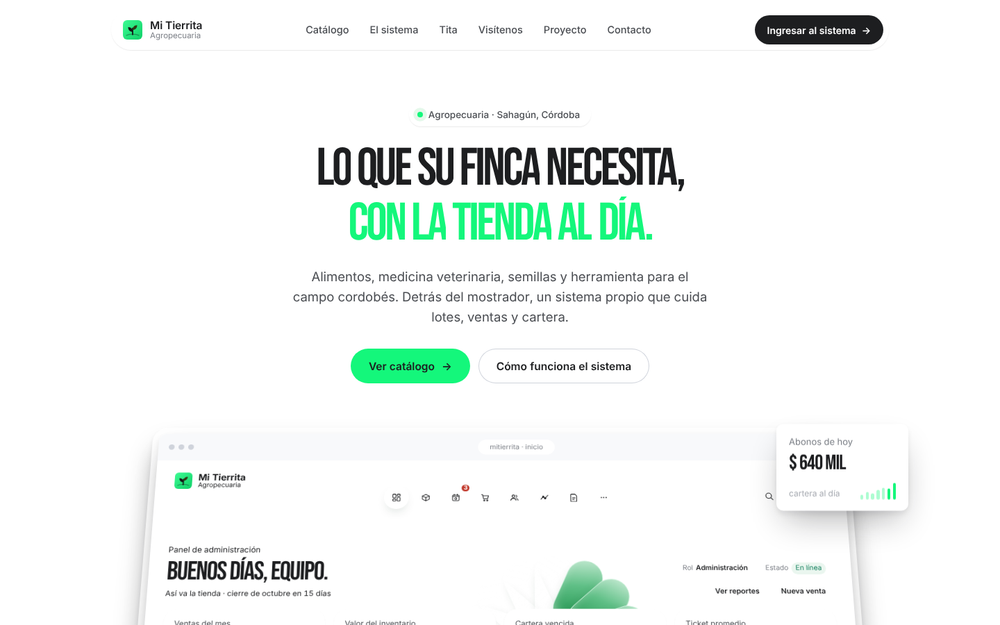

| Inicio de sesión | Tablero gerencial |
|---|---|
| 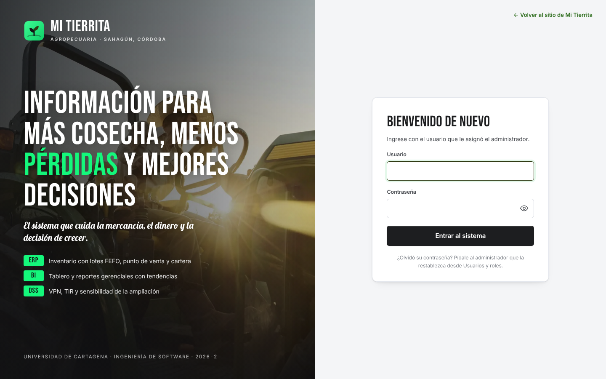 |  |
| **Chat del equipo · #general** | **Chat privado con chulitos** |
|  | 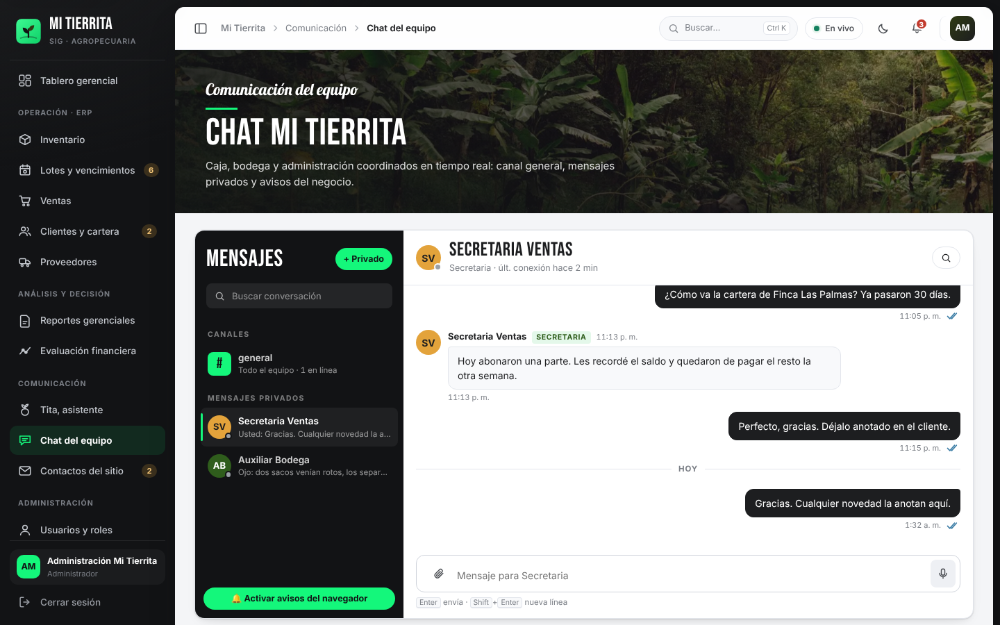 |
| **Notificaciones en vivo** | **Búsqueda global (Ctrl + K)** |
| 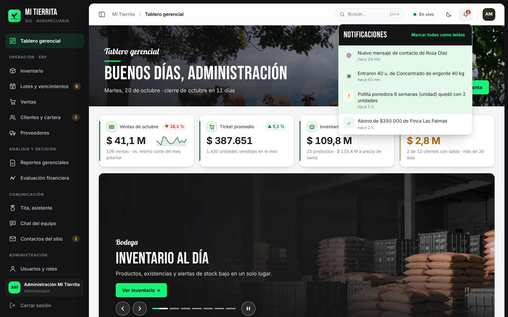 | 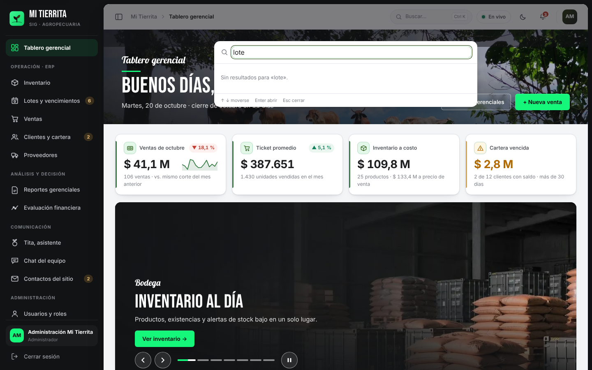 |
| **Lotes y vencimientos** | **Punto de venta** |
|  | 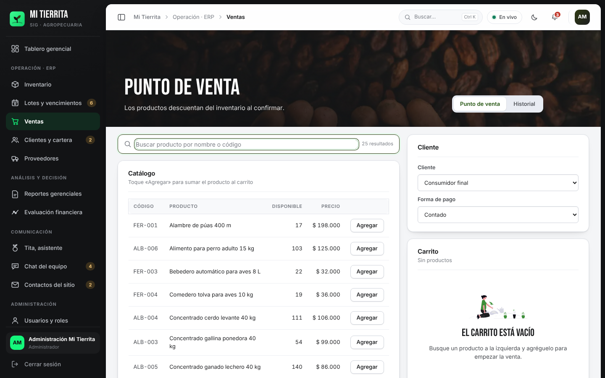 |
| **Clientes y cartera** | **Evaluación financiera** |
|  | 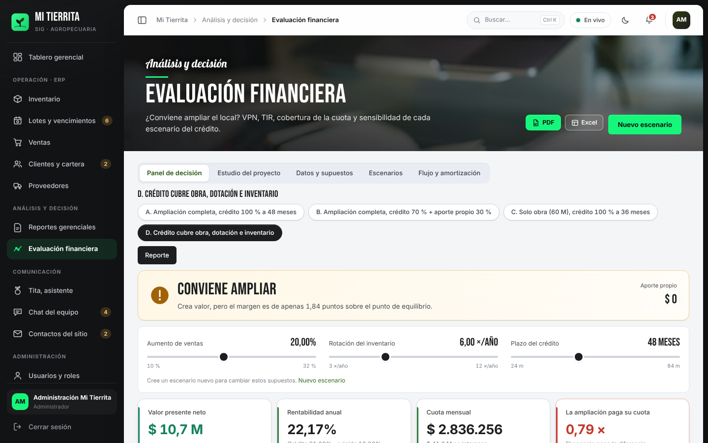 |
| **Reportes gerenciales** | **Mi perfil** |
|  |  |
| **Mi actividad** | **Auditoría de reportes** |
|  | 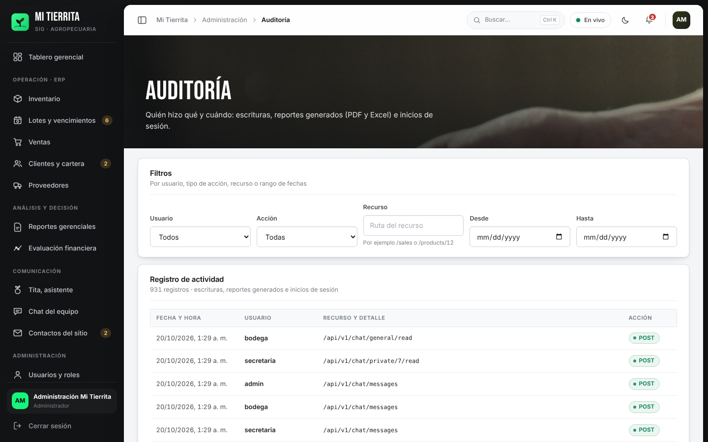 |
| **Detalle de recibos (solo el autor)** | **Reporte de ventas en PDF** |
| 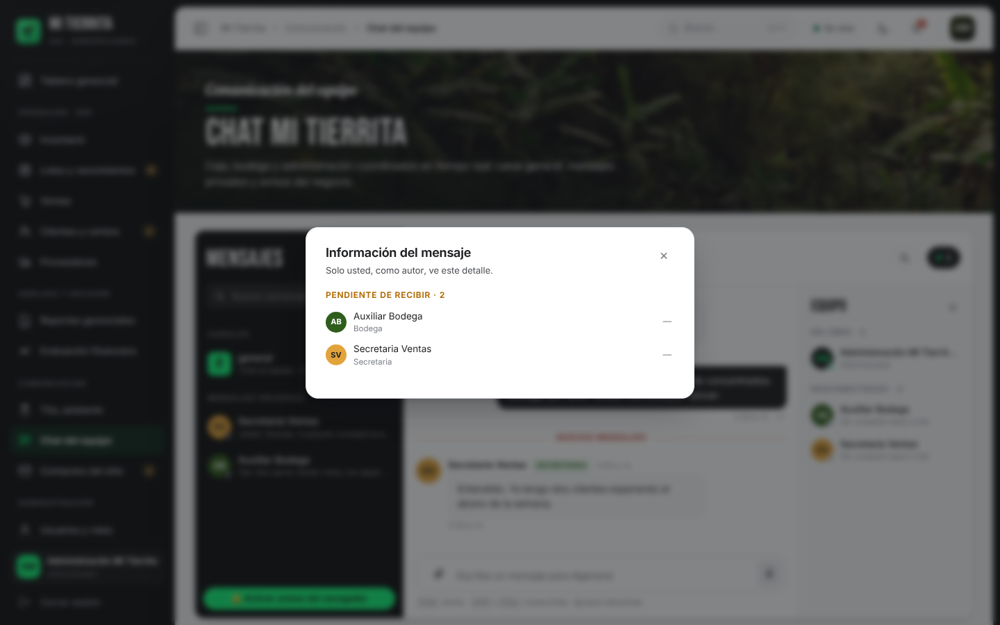 | 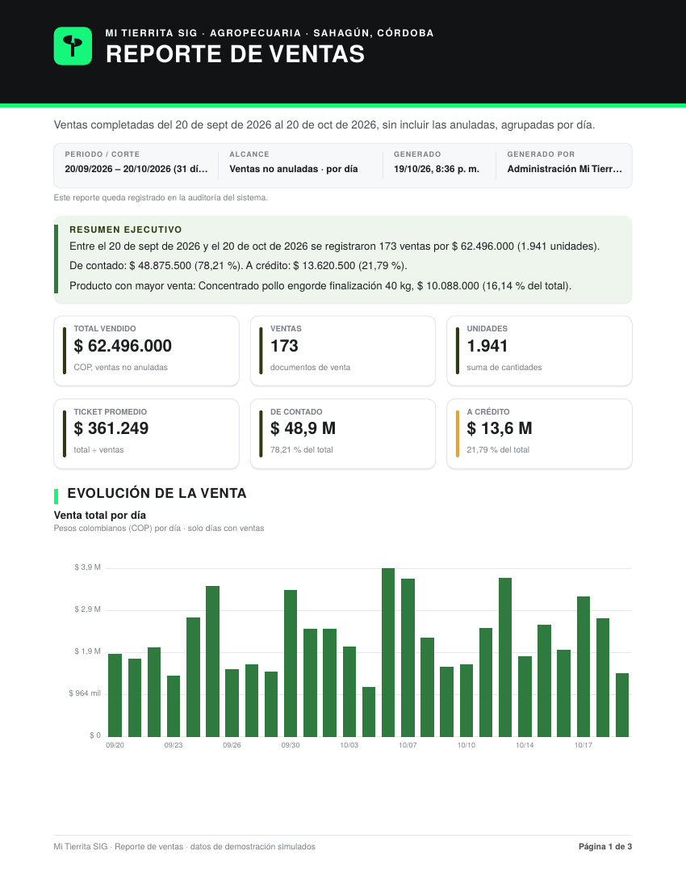 |
| **Página pública · catálogo** | **Preferencias de tema** |
| 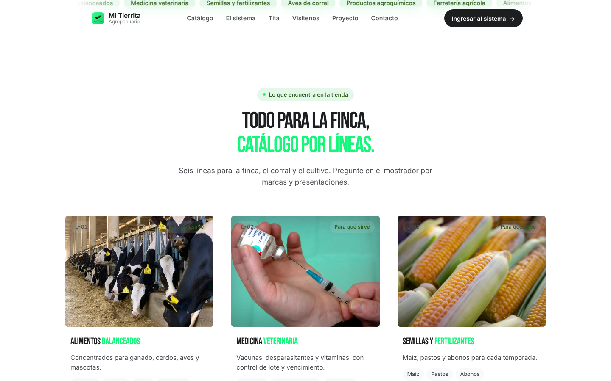 | 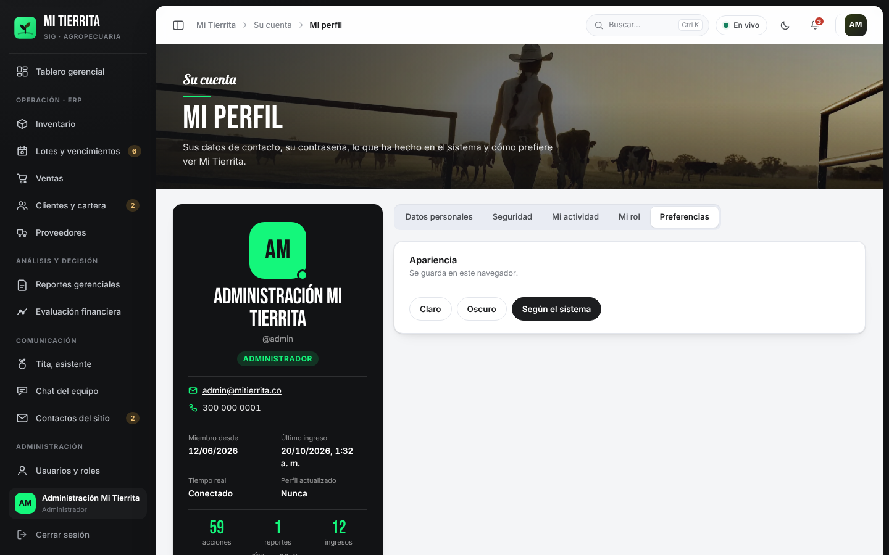 |

**Modo oscuro**


| Celular: página de inicio | Celular: tablero | Celular: venta | Celular: chat |
|---|---|---|---|
|  | 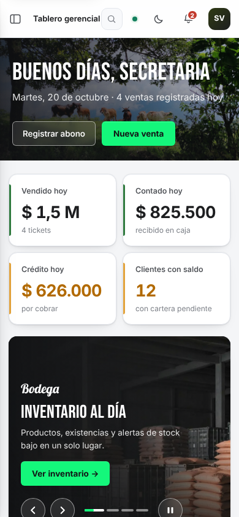 |  | 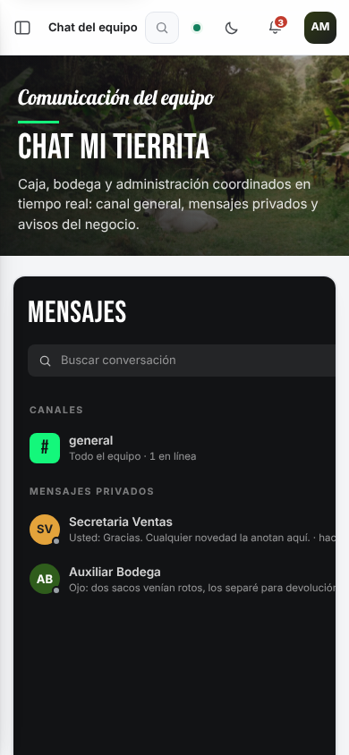 |

---

## Fases del Desarrollo

| Versión | Alcance en el cliente | Estado |
|---|---|---|
| v1 · Base | Autenticación, inventario, lotes, ventas, clientes, proveedores, finanzas, reportes, usuarios y auditoría | Completado |
| v2 · «Tierra viva» | Rediseño visual completo, tablero gerencial SIG + BI + DSS, estudio del proyecto, tema oscuro, móvil | Completado |
| v3 · Experiencia inmersiva | Escenas 3D del negocio (retiradas en v4 a pedido de la autora) | Reemplazado |
| v4 · «Campo abierto» | Se retira el 3D. Línea editorial agrotecnológica: portadas fotográficas, Bebas Neue + Lobster + Inter, carbón y verde lima, tres frentes ilustrados, pie negro | Completado |
| v4.2 · Reportes y perfil | Reportes en PDF con gráficos y Excel generados por la API, historial de reportes y auditoría por acción, Mi perfil completo, inicio de sesión sin atajos de demostración | Completado |
| v4.3 · Pulido visual | Sistema de diseño en tokens (espacio, tipografía, elevación, foco, movimiento), estados en todo control, Modal accesible, vista previa de reportes con «Guardar como…», carruseles y fondos fotográficos | Completado |
| v4.5 · Chat avanzado, tema y Tita | Chat con chulitos por persona, citas, hilos, fijados, menciones, adjuntos y voz; tema claro/oscuro/sistema; Tita (asistente con IA, opcional); página pública de Matos; en `main` | Completado · falta publicar en Seenode |
| v4.1 · Sitio y tiempo real | Página pública completa con contacto y boletín; chat con Socket.io, presencia, notificaciones, datos en vivo, búsqueda global, Mi perfil, contactos del sitio, ErrorBoundary, 404 ilustrado, exportación PDF | Completado · falta publicar en Seenode y validar con usuarios reales |

---

## Autores

| Nombre | Programa | TCC |
|---|---|---|
| Karina Redondo Sáez | Ingeniería de Software | Sistemas de Información Gerencial · Ingeniería Económica |
| Alexa Patricia Ricardo Lozano | Ingeniería de Software | Sistemas de Información Gerencial · Ingeniería Económica |
| Edgar Alexander Matos Rivera | Ingeniería de Software | Ingeniería Económica |

Universidad de Cartagena · Facultad de Ingeniería · Sede Cereté  
Sistemas de Información Gerencial (AL17705) · Docente: Esp. Luis Antonio Sarruf Durango  
Ingeniería Económica · Docente: Estrella del Carmen Camacho Alvis

---

## Notas Académicas

- Proyecto desarrollado con fines académicos como Trabajo Colaborativo Contextualizado del semestre 2026-2.
- Los datos de las capturas y de la demostración son **simulados** por el sembrado de la API; las cifras financieras
  son supuestos académicos, no la contabilidad real del negocio.
- Fotografías de Unsplash (licencia Unsplash) e ilustraciones de unDraw (licencia libre); créditos en `public/img/CREDITOS.txt`.
- El diseño UX/UI se hizo en Figma antes de programar; la interfaz final lo sigue y lo amplía.
