# Manual de usuario · Mi Tierrita SIG (guía rápida)

> Versión completa por rol, con más capturas: `entregables/Compartidos/Manual_de_usuario_MiTierrita.pdf` en la carpeta
> del proyecto. Las cuentas las entrega el administrador; la pantalla de ingreso ya no muestra atajos de demostración.

## 1. La página pública

Quien abre el sitio sin sesión ve la página de la tienda: portada, ¿Qué es?, tres frentes, catálogo, quiénes somos,
contacto y pie con boletín. El formulario de **Contacto** llega al instante a la campana del administrador
(máximo 5 mensajes por hora desde la misma conexión). **Ingresar al sistema** lleva al inicio de sesión.

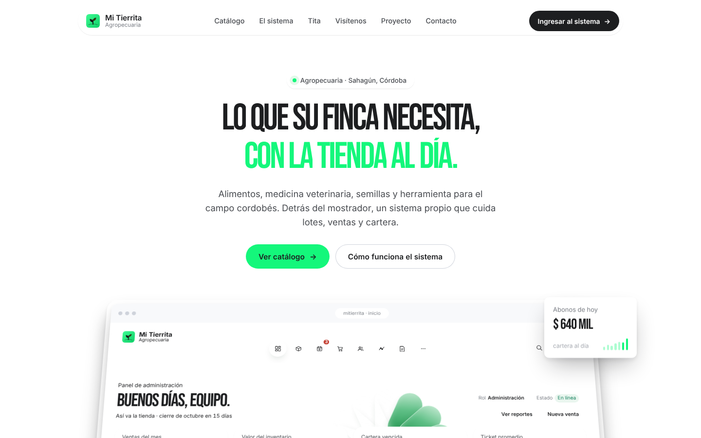

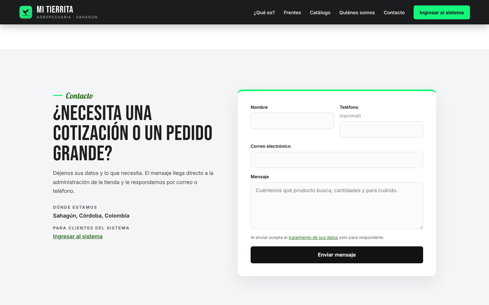

## 2. Ingresar

Escriba su usuario y contraseña y pulse **Entrar al sistema**. Después de 10 intentos en 15 minutos hay que esperar.
**Volver al sitio de Mi Tierrita** regresa a la página pública.

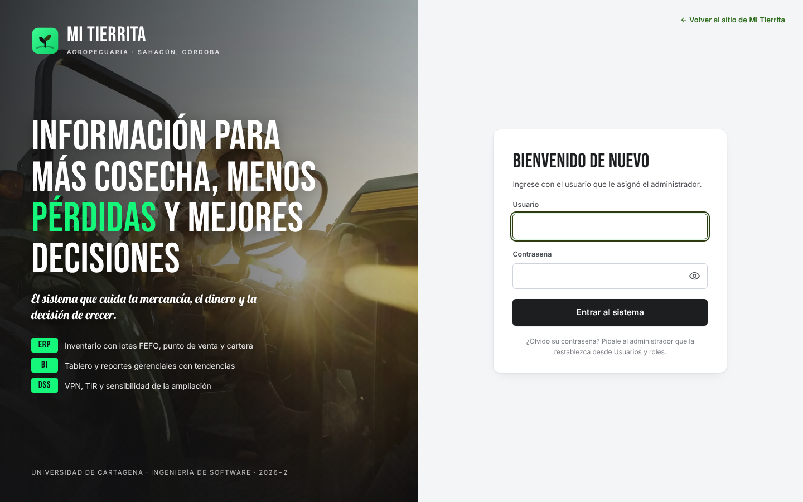

## 3. La pantalla principal

- **Menú lateral:** *Operación · ERP*, *Análisis y decisión*, *Comunicación* (chat y contactos del sitio) y
  *Administración*. Solo aparece lo que su rol puede usar; los números son pendientes.
- **Barra superior:** **Buscar… Ctrl K**, el estado de conexión, tema claro/oscuro, la **campana** y sus iniciales
  (abren **Mi perfil**).
- Cada rol tiene su inicio: el administrador lee los **tres frentes**; la secretaria, sus ventas del día; bodega,
  **qué hacer hoy**.

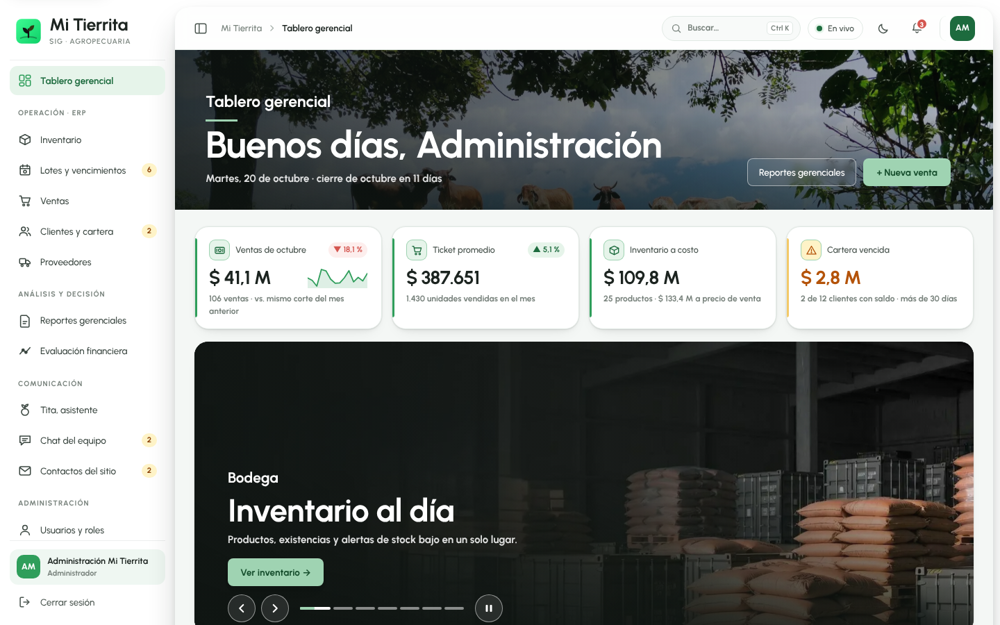

| Secretaria | Bodega |
|---|---|
| 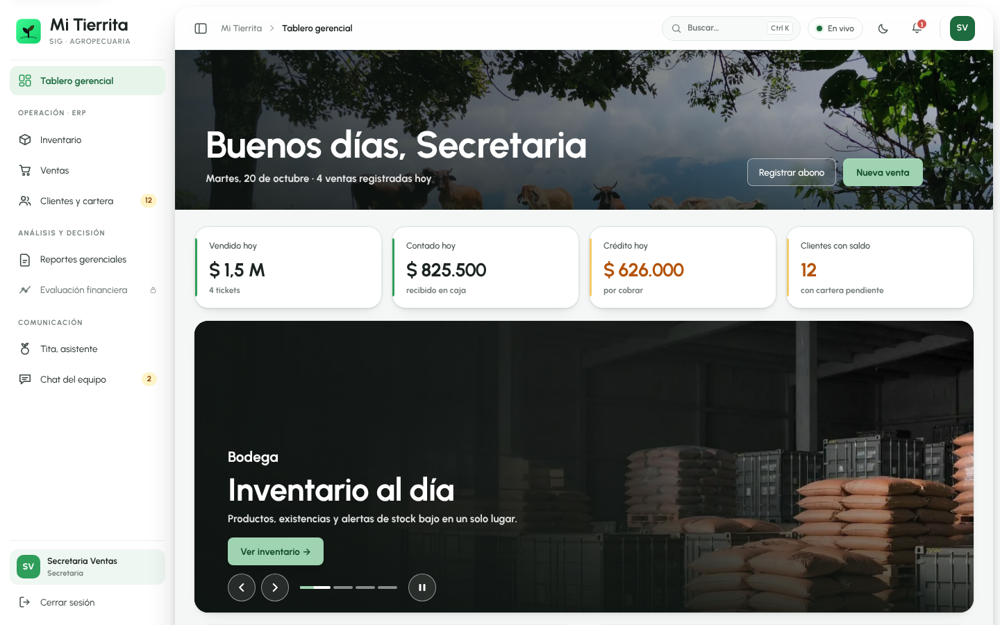 | 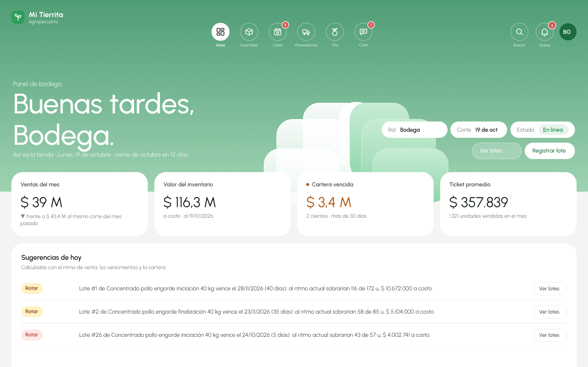 |

### Indicador de conexión

| Indicador | Significado |
|---|---|
| ● En vivo | Todo funciona; los mensajes y los cambios de los demás llegan al instante |
| ● Sincronizando… | Está trayendo datos |
| ● Reconectando… | Se perdió la conexión; reintenta sola. Al volver aparece «Conexión restablecida» y la pantalla se recarga |

## 4. Buscar

**Ctrl + K** (o `/`) y escriba dos letras: productos con existencia, clientes con saldo, ventas por factura,
proveedores y personas. Flechas para moverse, **Enter** para abrir; una persona abre el chat privado.

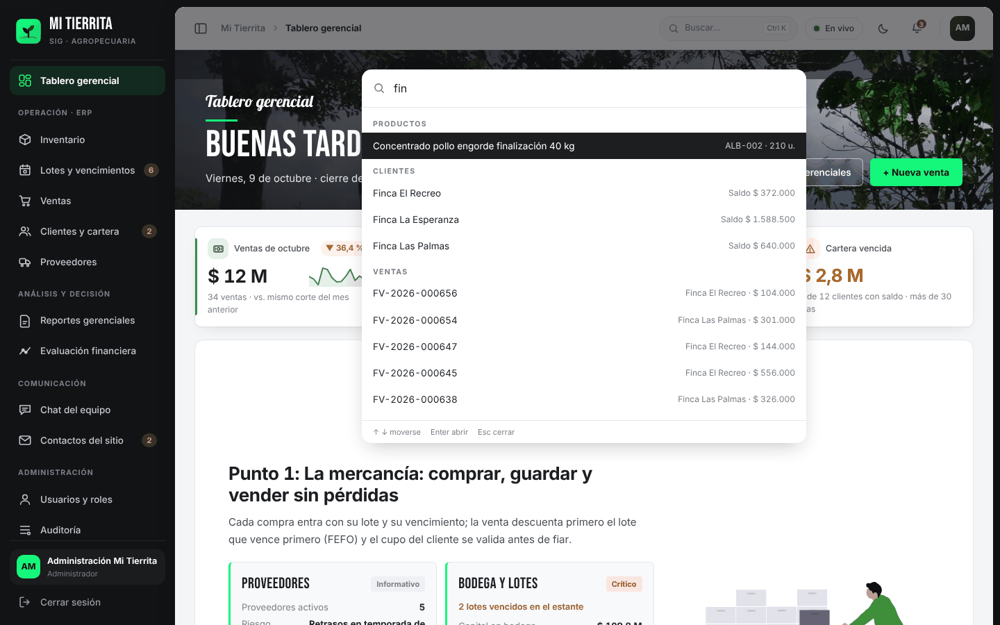

## 5. Chat del equipo

- **#general** para todos y **mensajes privados** (botón **+ Privado**, o clic en la persona en el panel *Equipo*).
- **Enter** envía, **Shift + Enter** hace salto de línea. Verá «… está escribiendo», quién está en línea y la última
  conexión de los demás; en los privados, **Enviado** y luego **✓✓ Leído**.
- Si lee mensajes antiguos y llegan nuevos, aparece **↓ N mensajes nuevos**. La pestaña muestra «(n)» con lo pendiente.

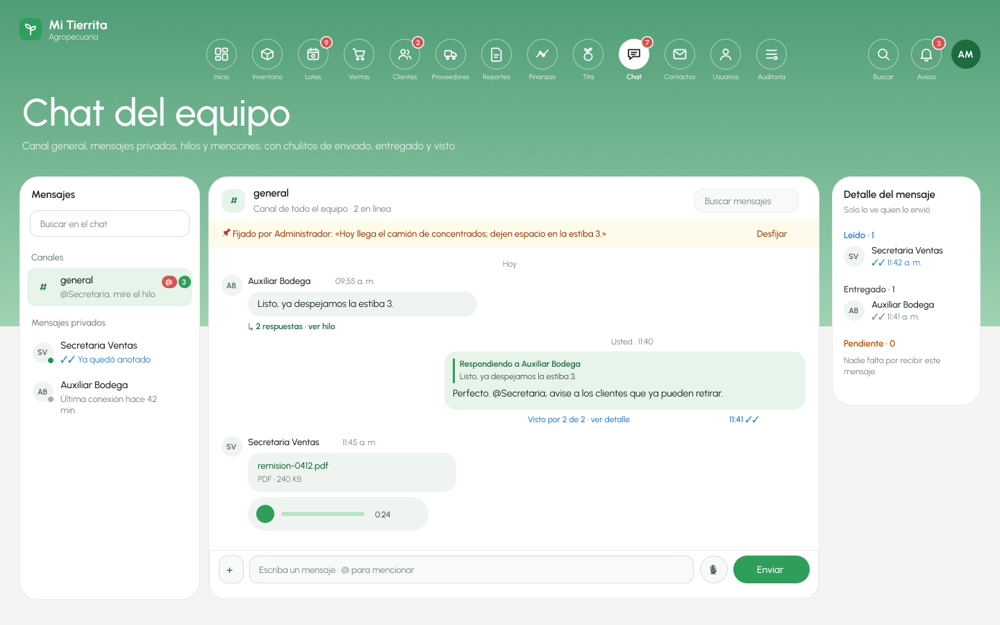

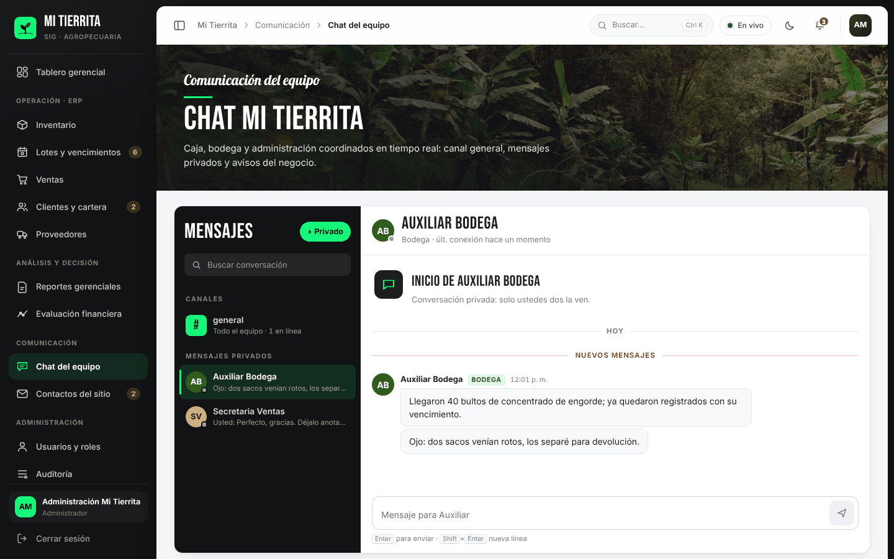

## 6. Notificaciones

| Aviso | Lo recibe |
|---|---|
| Venta registrada · abono · escenario nuevo · contacto del sitio | Administrador |
| Producto con 5 unidades o menos · entrada de mercancía | Administrador y bodega |
| Venta anulada | Administrador y secretaria |

Pulse un aviso para ir al módulo; **Marcar todas como leídas** limpia el contador. Quien hace la acción no recibe su
propio aviso.

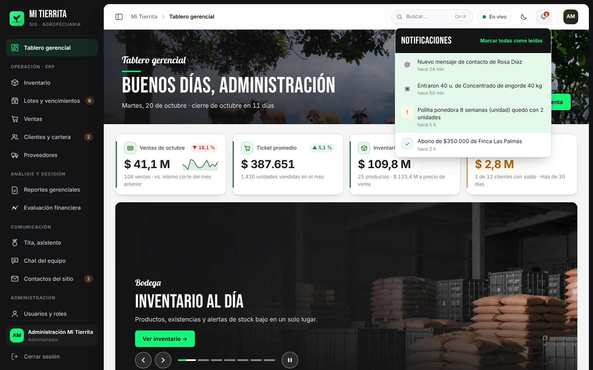

## 7. Operación diaria

- **Secretaria · Ventas:** busque el producto, ajuste cantidades, elija el cliente (a crédito verá cupo, saldo y
  disponible) y **Confirmar venta**. La salida es FEFO: primero el lote que vence primero.
- **Secretaria · Clientes:** **Registrar abono**; el saldo cambia en todas las pantallas abiertas.
- **Bodega · Lotes:** rojo = vencido (retirar), dorado = vence pronto (sacar al frente).
- **Bodega · Proveedores:** **Registrar compra** crea el lote con su vencimiento y avisa al administrador.

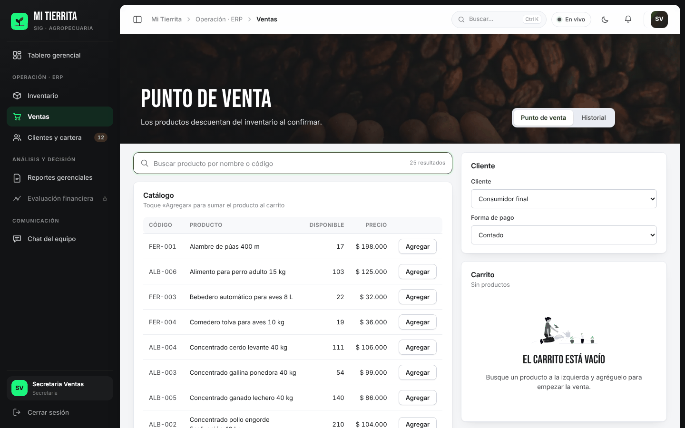

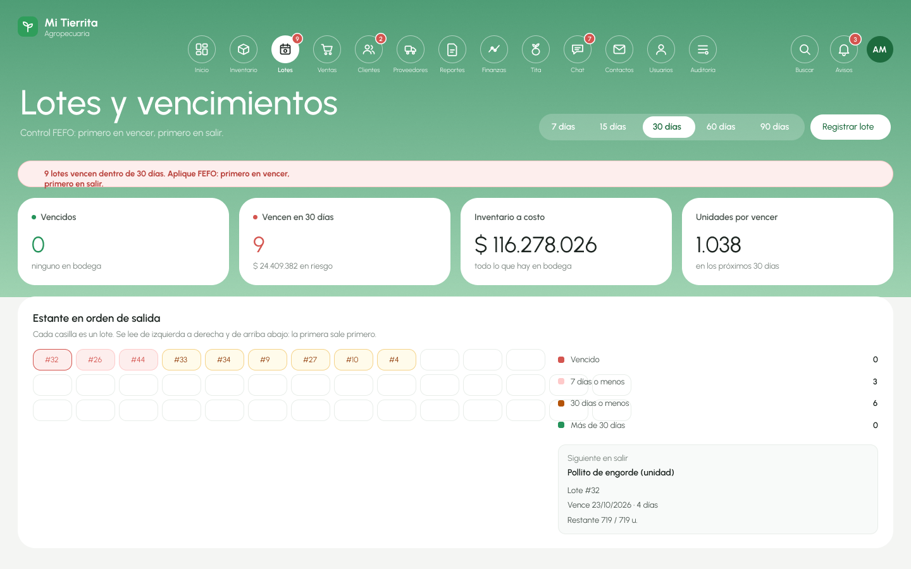

## 8. Administración y decisión

- **Evaluación financiera:** panel de decisión con el veredicto, estudio del proyecto, supuestos, escenarios y flujo.
- **Reportes:** elija el reporte, ajuste los filtros y pulse **PDF** (indicadores, gráficos y detalle) o **Excel**
  (hojas formateadas). El documento dice quién lo generó y a qué hora. Abajo, **Historial de reportes generados**
  muestra cada descarga; la secretaria ve solo las suyas. En **Evaluación financiera** los mismos botones descargan
  el escenario elegido (VPN, TIR, flujo y tornado).
- **Contactos del sitio:** responda por correo y pulse **Marcar atendido**.
- **Usuarios y roles · Auditoría:** alta de usuarios y bitácora. El filtro **Acción** separa altas, cambios,
  borrados, **reportes generados** e **inicios de sesión**; la columna de detalle dice qué reporte y con qué filtros.

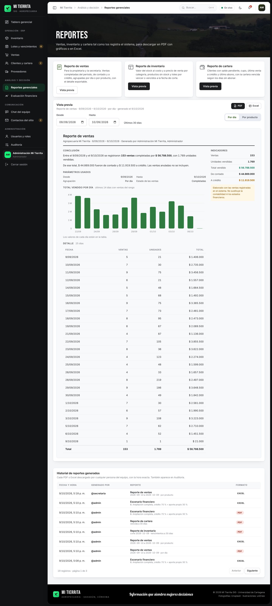

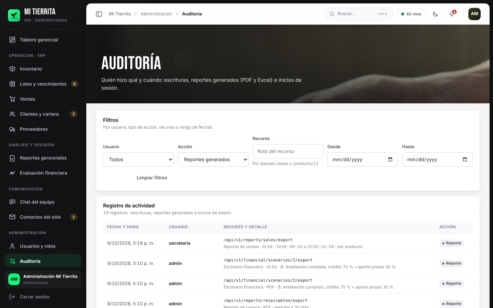

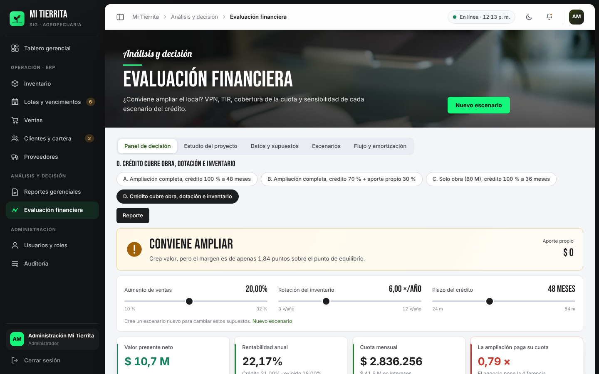

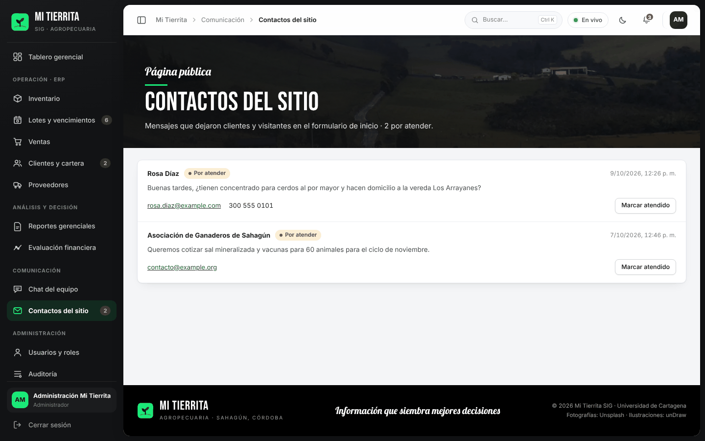

## 9. Perfil y tema

Sus iniciales abren **Mi perfil**. A la izquierda, su tarjeta: nombre, rol, correo, teléfono, último ingreso y lo
que ha hecho en 30 días. A la derecha, cinco pestañas:

| Pestaña | Qué hace |
|---|---|
| Datos personales | Nombre, apellido, correo (único en el equipo) y teléfono. Usuario y rol solo los cambia el administrador |
| Seguridad | Cambio de contraseña con requisitos a la vista y **Cerrar sesión en todos los dispositivos** |
| Mi actividad | Ventas, abonos, lotes y reportes de los últimos 30 días y la lista de sus últimas acciones |
| Mi rol | Lo que puede hacer y a qué no tiene acceso |
| Preferencias | Claro, oscuro o según el sistema |

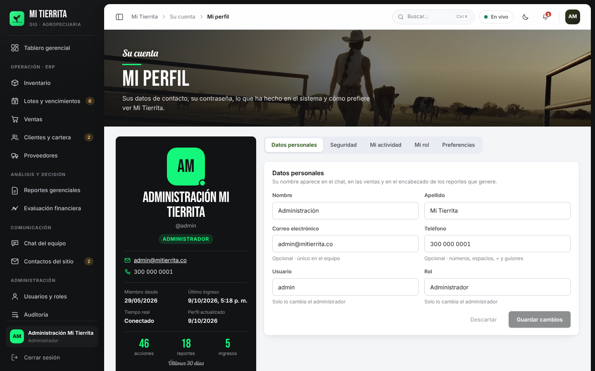

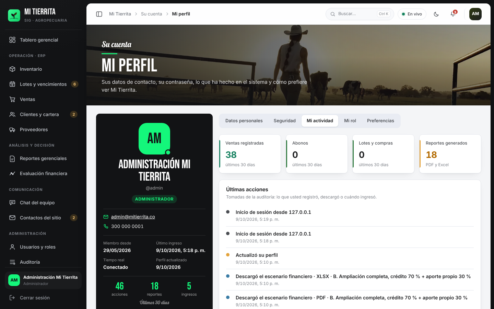

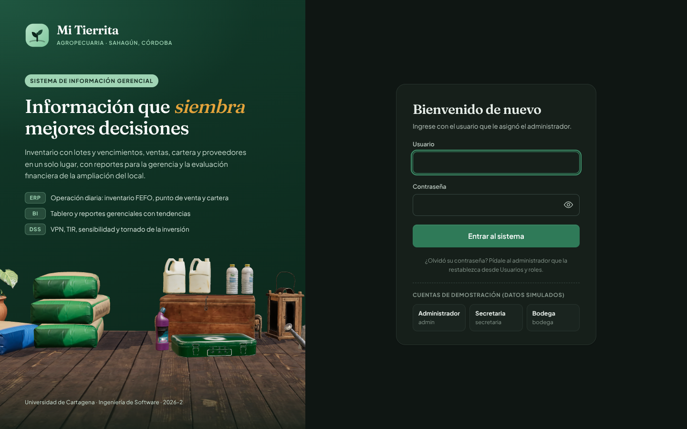

## 10. En el celular

El menú se abre con el botón de la esquina; en el chat se ve primero la lista y luego el hilo con ← para volver.

| Página pública | Tablero | Venta | Chat |
|---|---|---|---|
| 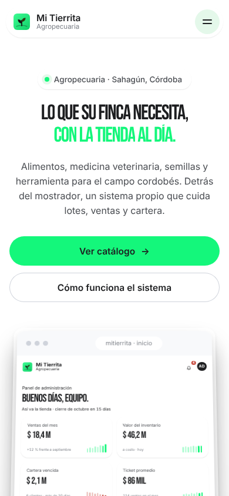 | 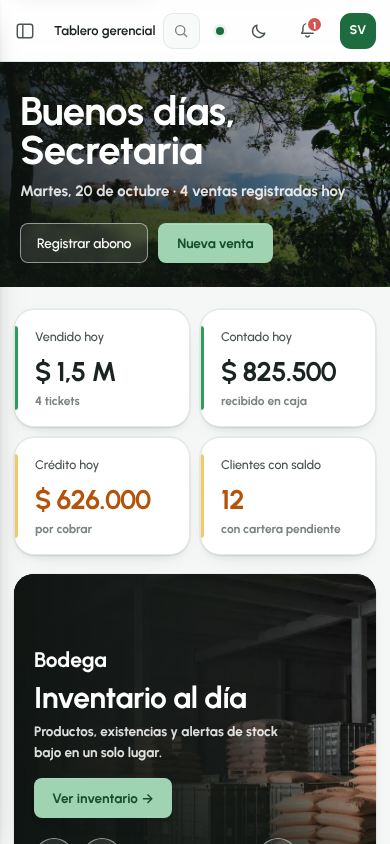 | 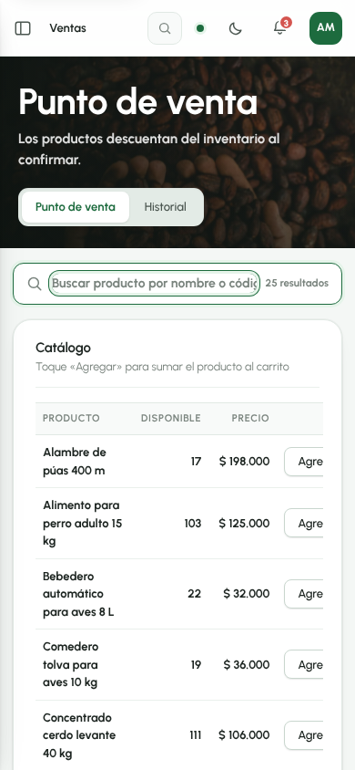 | 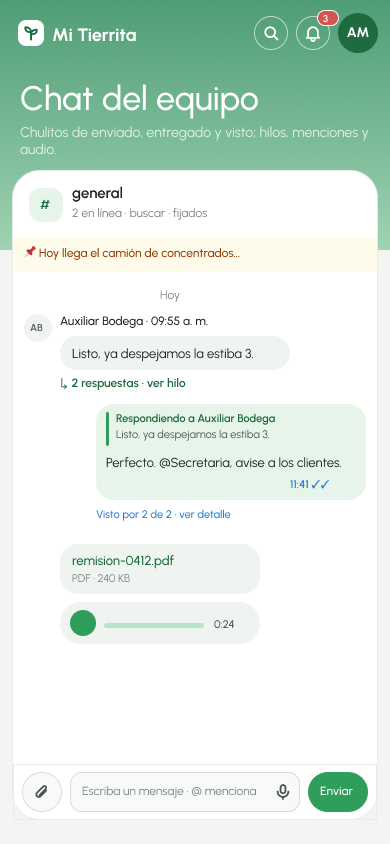 |

## 11. Si algo falla

| Situación | Qué hacer |
|---|---|
| «Acceso restringido» | Esa pantalla es de otro rol; vuelva al tablero |
| «Esta página no está sembrada» (404) | La dirección no existe; **Volver al tablero** |
| «Algo salió mal en esta pantalla» | **Reintentar**; los datos están a salvo en el servidor |
| «Reconectando…» | Espere; el chat sigue enviando por el respaldo y todo se actualiza al volver |
| Olvidé la contraseña | El administrador asigna una nueva; luego cámbiela en Mi perfil |
